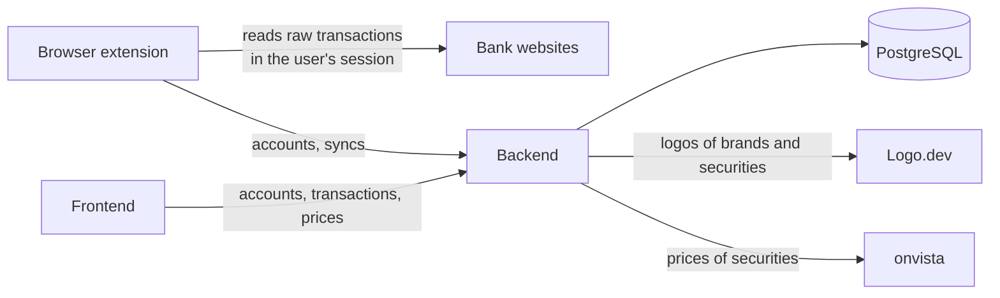

# Finance Tracker

A single-user, self-hosted personal finance tracker that collects the transactions of its user's bank accounts and lets the user view and manage them.

## Supported accounts

- ING (cash)
- Trade Republic (cash, depot)
- Deutsche Bank (cash, depot)
- finvesto (depot)

## Architecture

Finance Tracker consists of three apps:

- a backend with PostgreSQL that stores all data
- a frontend in which the user views and manages that data
- a Firefox browser extension that reads the transactions from the bank websites in the user's own sessions

One user owns all data, so the system manages no users or permissions, and it holds no bank credentials, because the browser extension reads only sessions the user opened.
The frontend and the browser extension reach the data only through the backend's [API](./docs/contract/api.md).

## Further reading

- [Banks](./docs/contract/banks.md): what each app gets from a bank.
- [Ingestion](./docs/contract/ingestion.md): how a sync brings an account's transactions into the backend, and how each adapter reads its bank.
- [Data model](./docs/contract/data-model.md): the tables, their columns and their relations.
- [API](./docs/contract/api.md): the backend's procedures and who calls them.
- [Prices](./docs/contract/prices.md): how security prices come from onvista.
- [Figures](./docs/contract/figures.md): how the frontend adds up its views' figures from transactions and prices.
- [Logos](./docs/contract/logos.md): how transactions get their brands, and brands and securities their logos from Logo.dev.
- [Hosting](./docs/contract/hosting.md): where the apps run, how the schema reaches the database, and how requests are authenticated.
- [Context](./docs/context/index.md): why the system is built as it is.
- [Contributing](./CONTRIBUTING.md): local setup, running the system, schema changes and the quality gate.

## License

[MIT](./LICENSE)
