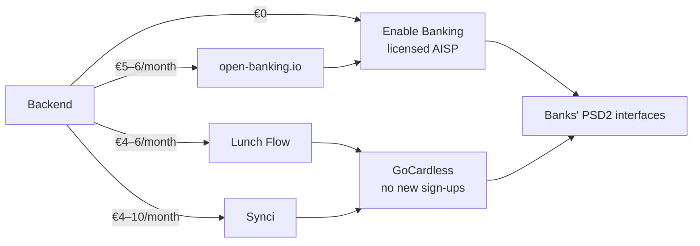
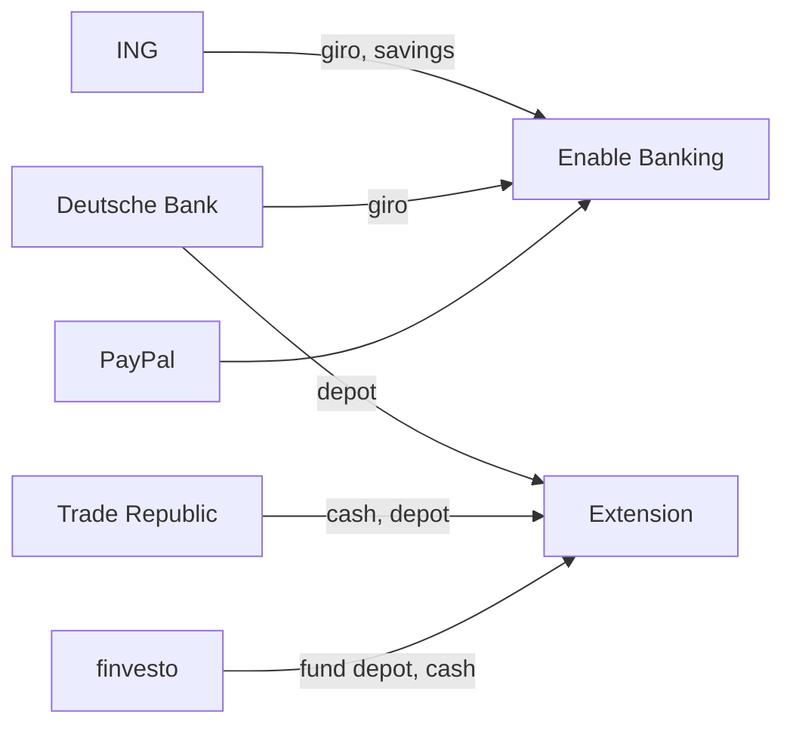

# Ingestion through Enable Banking and the extension

Enable Banking, in its free restricted mode, reads every account whose bank delivers usable PSD2 data, and the Firefox extension reads the rest ([ingestion](../architecture.md#ingestion)).
The comparison ran on 2026-11-09 with a budget of up to €10/month and weighed price, coverage and data per bank alongside eligibility, consent, raw-data access, vendor risk and setup.

## The bank decides the data

- Over PSD2, the bank's own interface decides which fields arrive, and aggregators pass them through unchanged ([Enable Banking on ING data][ff-12811]).
- Aggregators can still drop fields in their mapping: Enable Banking's PayPal data lacks the booking date and the euro amount of foreign-currency purchases, which PayPal's own PSD2 interface provides ([Sure #1193][sure-1193], [Firefly III #13163][ff-13163], [PayPal XS2A][pp-xs2a]).
- Aggregators therefore differ mainly in price, coverage, raw-data access, intermediaries and vendor risk.
- PSD2 covers payment accounts only, so no aggregator reaches a depot.

## Candidates

| | Enable Banking | open-banking.io | Lunch Flow | Synci |
| --- | --- | --- | --- | --- |
| Price | free for personal use ([terms][eb-terms]) | €3 + €1 per extra account ([billing][obio-billing]) | €5.49/month for 4 connections + €1 each, or €34.99/year for 2 + €10 each ([pricing][lf-pricing]) | Basic €0.99 + €1 per connection, keeping 60 days; Pro €3.99 + €1.50 ([pricing][synci-pricing]) |
| Provider underneath | itself, registered AISP with the Finnish FSA ([terms][eb-terms]) | Enable Banking ([DPA][obio-dpa]) | GoCardless ([security][lf-sec]) | GoCardless ([changelog][synci-changelog]) |
| ING · Deutsche Bank · PayPal | ✓ · beta · ✓ ([banks][eb-banks]) | ✓ · beta · ✓ | ✓ · ✓ · ✓ | ✓ · ✓ · ✓ |
| Trade Republic | amount, currency and booking date only ([DE notes][eb-de]) | ✗ | ✗ | ✗ |
| finvesto cash account | ✗ | ✗ | ✓ | ✓ |
| Raw bank JSON | direct | inside an encrypted envelope that the Node SDK drops ([models][obio-models]) | `include_raw=true` ([OpenAPI][lf-openapi]) | unknown |
| Who fetches | backend, about 4 unattended fetches per day per bank ([FAQ][eb-faq]) | backend | Lunch Flow, daily | Synci, every 6 or 2 hours |
| Consent | 180 days, Trade Republic 90 | mostly 90 days | 90 days | 180 days |
| Operator | company since 2019, profitable since 2025 ([Sifted][eb-sifted]) | commercial since May 2026, support silences reported ([#207][obio-i207]) | company formed November 2024 ([Companies House][lf-ch]) | small vendor, active changelog |

## Data per bank

| Bank | Usable API route | What the API delivers | Richer route |
| --- | --- | --- | --- |
| ING | PSD2 | stable transaction ID, booking and value date, counterparty name and IBAN, purpose text behind a fixed prefix, pending flag ([ING spec][ing-spec]) | none needed |
| Deutsche Bank | PSD2, beta | fields unverified; Deutsche Bank publishes none ([PSD2 FAQ][db-faq]) | FinTS in CAMT format ([Quaestor #158][quaestor-158]) or the website |
| PayPal | PSD2 | ID, counterparty name and email, amount in the original currency, transaction date; no description ([Sure #1193][sure-1193]) | website with item titles, fees and conversions |
| Trade Republic | none | amount, currency and booking date, no ID ([DE notes][eb-de]) | web app or CSV export with IDs, counterparty, IBAN, exchange rates and trades ([CSV extractor][tr-csv]) |
| finvesto | none for individuals | nothing | portal; a proprietary channel serves only StarMoney, MoneyMoney and WISO ([FondsSuperMarkt][fsm-fnz]) |

## Routing

- An Enable Banking account whose data proves unusable after sign-up moves to the extension, and so does the ING savings account if Enable Banking cannot link it.
- Ingestion keeps exactly these two routes; FinTS, unofficial clients and other data services stay out.

## Why Enable Banking

- Personal use costs nothing and has no time limit: "Use of the Control Panel and the API under these Terms is free of charge" ([terms][eb-terms]).
- It is the licensed provider itself, so no reseller sits between the backend and the bank, and the backend receives the raw bank JSON.
- A reseller delivers the same data per bank, so paying for one buys an extra party rather than richer data.
- Its 180-day consents halve renewals compared with 90-day offers.
- Actual Budget and Firefly III rely on it for the same bring-your-own-application use ([Actual Budget][actual-eb], [Firefly III][ff-eb]).

## Not chosen

- open-banking.io runs on Enable Banking and adds cost, an encryption layer the backend must undo, and one more party.
- Lunch Flow and Synci depend on GoCardless, which takes no new sign-ups ([notice][gc-signups]) and was acquired by Mollie on 2026-09-01 ([The Paypers][mollie]); their only coverage gain is finvesto's cash account, which has no transactions.
- FinTS is free and direct and adds depot holdings, but the backend would store the bank PIN, every user needs a product registration with Die Deutsche Kreditwirtschaft ([fints.org][fints-reg]), and ING's FinTS returns no transaction ID and only 90 days ([ING][ing-fints]).
- Unofficial Trade Republic clients such as [pytr][pytr] and [trade-republic-sdk][trsdk] deliver rich data but keep a session from a phone-and-PIN login and break whenever Trade Republic changes its login.
- The [Parqet Connect API][parqet] is free but covers Trade Republic securities only, without card merchants, and would be a third route.
- Bank-own APIs exclude private customers: Deutsche Bank's dbAPI serves businesses only ([FAQ][dbapi]), ING requires eIDAS certificates, and PayPal serves licensed partners ([TPP API][paypal-tpp]) or Business accounts ([policy][paypal-policy]).
- finAPI (from €60/month, [prices][finapi]), Tink ([pricing][tink]), Salt Edge, Plaid ([pricing][plaid]), TrueLayer, Yapily, wealthAPI and Ponto exceed the budget or serve businesses only, and BankSync keeps Germany on a waitlist ([pricing][banksync]).

## Risks and fallback

- Enable Banking may change or discontinue the free mode, may limit linked accounts per application without a published figure, and caps its liability at €100 ([terms][eb-terms]).
- Deutsche Bank is in beta at Enable Banking.
- Within budget, open-banking.io delivers the same data for €5–6/month, Lunch Flow covers ING, Deutsche Bank and PayPal for €4–6/month, and any bank can move to the extension.

## Unknowns

The Control Panel's Data Insights page shows field presence and history length per bank after sign-up ([FAQ][eb-faq]), which settles these, as tracked in [#4](https://github.com/lennartmoeller/finance-tracker/issues/4):

- which fields Deutsche Bank fills;
- how much history each bank returns on the first fetch;
- whether the ING savings account can be linked.

[actual-eb]: https://actualbudget.org/docs/advanced/bank-sync/enable-banking
[banksync]: https://banksync.io/pricing
[db-faq]: https://www.deutsche-bank.de/pk/lp/xs2a/psd2-faq.html
[dbapi]: https://ams-prd.developer.db.com/c2/faqs.model.json
[eb-banks]: https://enablebanking.com/api/aspsps?country=DE
[eb-de]: https://enablebanking.com/docs/markets/de/
[eb-faq]: https://enablebanking.com/docs/faq/
[eb-sifted]: https://enablebanking.com/blog/2026/09/01/enable-banking-named-45-on-the-sifted-100-nordics-2026
[eb-terms]: https://enablebanking.com/terms
[ff-12811]: https://github.com/orgs/firefly-iii/discussions/12811
[ff-13163]: https://github.com/firefly-iii/firefly-iii/issues/13163
[ff-eb]: https://github.com/firefly-iii/docs/blob/main/docs/docs/tutorials/data-importer/eb.md
[finapi]: https://www.finapi.io/en/prices/
[fints-reg]: https://www.fints.org/de/hersteller/produktregistrierung
[fsm-fnz]: https://www.fonds-super-markt.de/neuigkeiten/artikel/fnz-bank-finanzplanungssoftware/
[gc-signups]: https://bankaccountdata.gocardless.com/new-signups-disabled
[ing-fints]: https://www.ing.de/hilfe/log-in/fints/
[ing-spec]: https://github.com/ing-bank/ing-open-banking-sdk/blob/master/api/account/information/Account-Information-API.json
[lf-ch]: https://find-and-update.company-information.service.gov.uk/company/16061160/officers
[lf-openapi]: https://www.lunchflow.app/api/v1/openapi.json
[lf-pricing]: https://www.lunchflow.app/docs/guides/account/pricing
[lf-sec]: https://www.lunchflow.app/docs/guides/account/security-privacy
[mollie]: https://thepaypers.com/mergers-aquisitions-and-investments/news/mollie-finalises-gocardless-acquisition-to-expand-payments-offer
[obio-billing]: https://open-banking.io/en/how-billing-works
[obio-dpa]: https://open-banking.io/en/dpa
[obio-i207]: https://github.com/open-banking-io/clients/issues/207
[obio-models]: https://github.com/open-banking-io/clients/blob/main/node/src/models.ts
[parqet]: https://developer.parqet.com/docs/build-your-first-parqet-integration
[paypal-policy]: https://developer.paypal.com/api/rest/reference/policies-and-guidelines
[paypal-tpp]: https://developer.paypal.com/limited-release/account-history-for-tpp/integrate
[plaid]: https://plaid.com/en-eu/pricing/
[pp-xs2a]: https://www.paypalobjects.com/devdoc/xs2a.pdf
[pytr]: https://github.com/pytr-org/pytr
[quaestor-158]: https://github.com/felixschndr/quaestor/issues/158
[sure-1193]: https://github.com/we-promise/sure/issues/1193
[synci-changelog]: https://synci.featurebase.app/changelog
[synci-pricing]: https://synci.io/pricing
[tink]: https://tink.com/pricing
[tr-csv]: https://github.com/portfolio-performance/portfolio/blob/master/name.abuchen.portfolio/src/name/abuchen/portfolio/datatransfer/traderepublic/TradeRepublicCSVExtractor.java
[trsdk]: https://www.npmjs.com/package/trade-republic-sdk
