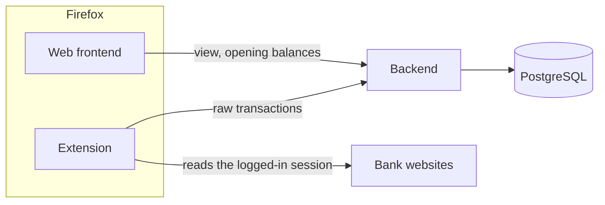
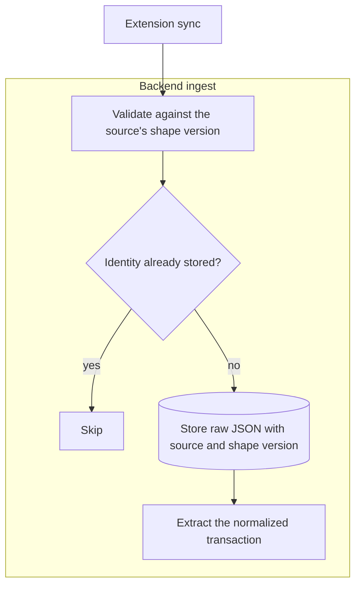
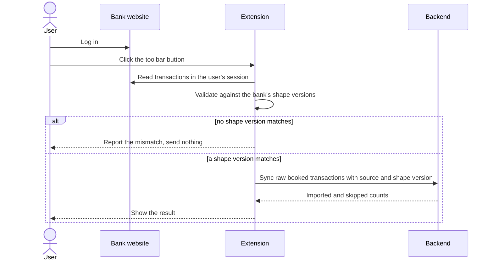
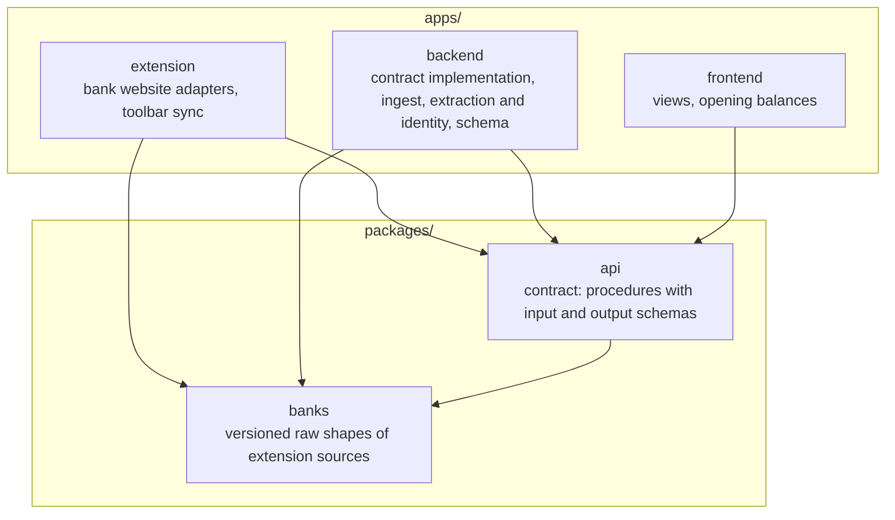
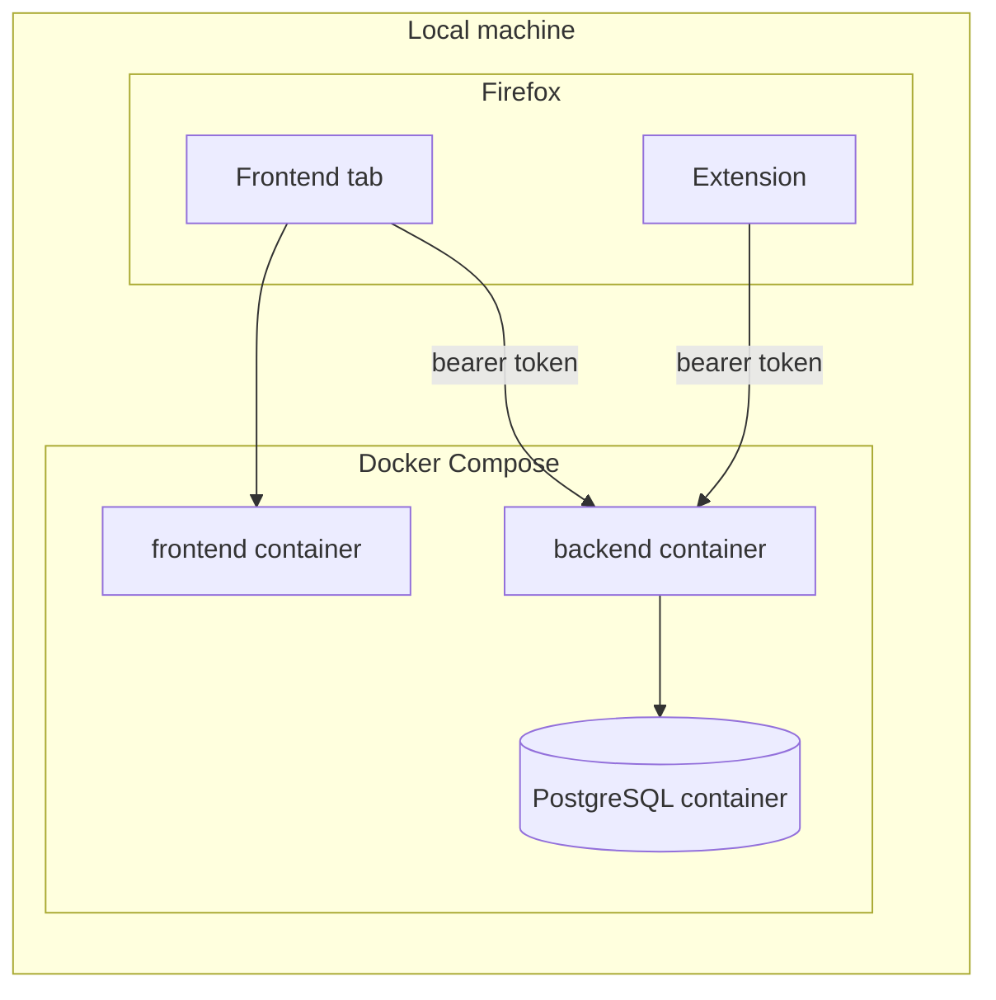

# Architecture

## System overview

- One user owns all data; the system manages no users and no permissions.
- The system never sees bank credentials, because the extension reads only sessions the user opened.
- Transaction data enters only through the extension; the frontend never changes it.

## Components

| Component | Owns | Leaves to others |
| --- | --- | --- |
| Web frontend | browsing, filtering and summarizing transactions per account; each account's opening balance; each bank's last sync | reading bank websites; talking to the extension |
| Backend | the API contract's implementation; validation, deduplication, raw storage and extraction | state outside PostgreSQL |
| Extension | one adapter per bank website; shape validation; the toolbar sync and its result | storing bank credentials; talking to the frontend |
| PostgreSQL | raw transactions, normalized transactions, each account's opening balance | |

The extension exists because a web page cannot read banking sites in the user's session: the same-origin policy and the banks' framing bans block it.
Why the web frontend and the extension stay separate is recorded in [ADR 0001](./adr/0001-separate-web-frontend-and-thin-extension.md).
Why every account takes the extension is decided in [ADR 0003](./adr/0003-ingestion-through-the-extension-only.md).

## Raw data and shape versions

- A source is one extension adapter per bank website.
- Each source's raw data follows a versioned shape; a format change at the bank adds a new shape version beside the existing ones.
- Every raw transaction is stored as JSON together with its source and the shape version it was validated against, and is never changed afterwards.
- A shape version's definition and extraction stay in the code as long as stored raw data follows it.
- Only booked transactions are imported, because pending ones change amount, date or ID when they book.
- A transaction's identity is the bank's own ID where the source carries one, otherwise a hash of stable fields with an occurrence counter for identical same-day entries; identities are always scoped to the account.
- Extraction turns a raw transaction into a normalized transaction and handles each bank's quirks.
- Re-extracting normalized data from stored raw data stays possible by design and is built only once needed.
- Database columns live in the backend's schema.

## Normalized transactions and balances

- A normalized transaction carries a date, an amount in the account's currency, a counterparty, and a description wherever the source has one.
- Its date is the booking date where the source has one, otherwise the transaction date.
- An account's balance is its opening balance plus the sum of its normalized transactions, so no transaction carries a balance.

## Ingestion

Ingest runs synchronously within the sync request, so the caller receives the imported and skipped counts.

## Extension sync

A mismatch means the bank changed its format and the adapter needs a new shape version.
What each bank website exposes, and reference code for reading it, is collected in the [extension sources research](./research/extension-sources.md).

## Repository layout

- Code used by more than one app lives under `packages/`, and code used by one app lives in that app.
- No app depends on another app.

## API contract

- The extension and the frontend call the backend through contract-first typed RPC.
- `packages/api` defines each procedure's name with its input and output schemas and contains no implementation.
- The backend implements the contract, and the extension and the frontend build typed clients from it.
- The RPC library must support contract-first definitions, which rules out plain tRPC because it derives the contract from the implementation.

## Hosting and security

- Everything runs on the user's machine now; the same containers move to a self-hosted Kubernetes cluster later, and that move adds the manifests and decides whether Docker Compose stays.
- Kubernetes compatibility means the backend keeps no state outside PostgreSQL, every app reads its configuration from environment variables, and each container serves one app.
- Every backend request carries a bearer token that the backend reads from its environment; the user enters it once in the extension's settings and once in the frontend.

## Technology

- All components are written in TypeScript, so bank shapes and the API contract each have one home; the backend runs on Node.js.
- Frameworks and libraries are picked when each component is built and live in its code.
