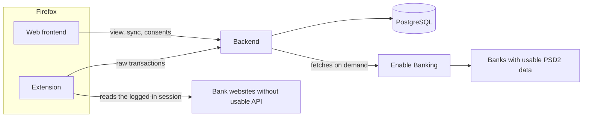
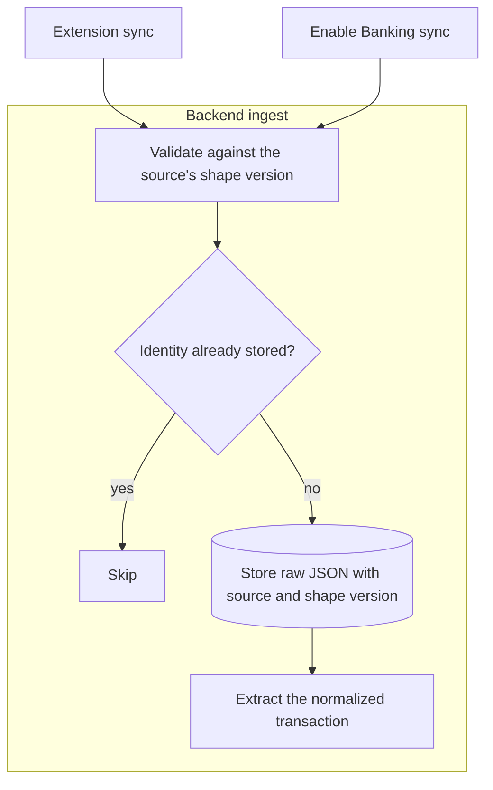
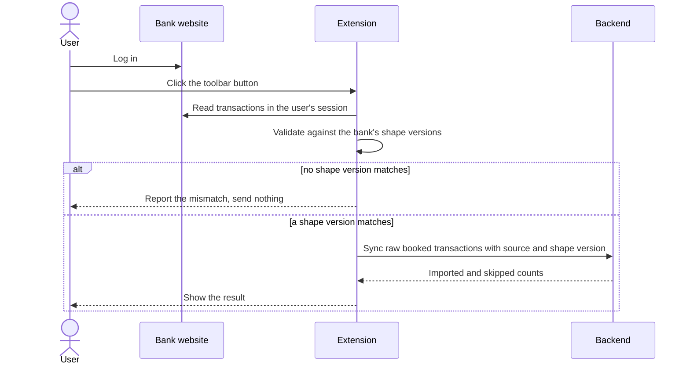
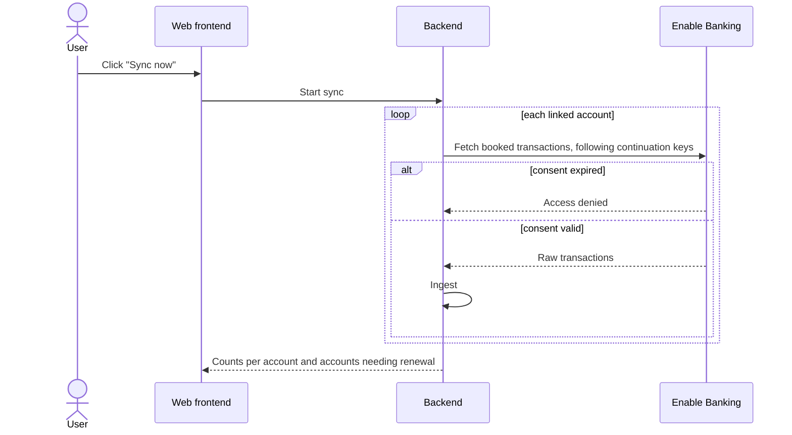
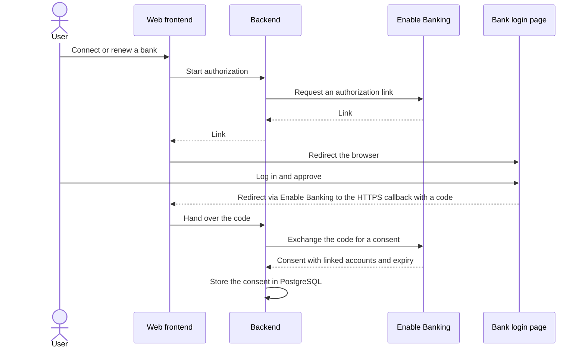
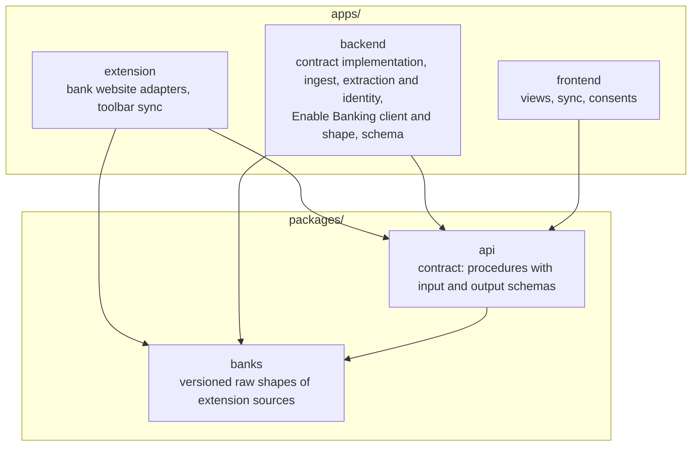
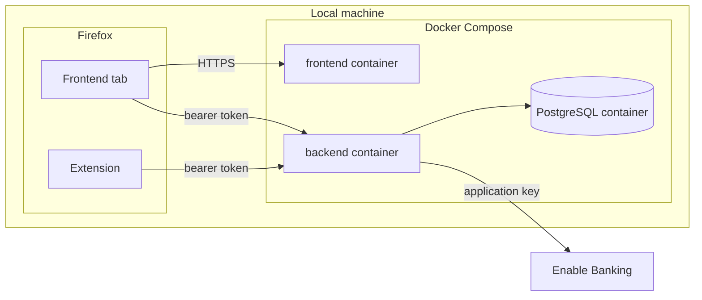

# Architecture

## System overview

- One user owns all data; the system manages no users and no permissions.
- The system never sees bank credentials: Enable Banking logins happen on the bank's own page, and the extension reads only sessions the user opened.
- Transaction data enters only through the two ingestion routes; the frontend never changes it.

## Components

| Component | Owns | Leaves to others |
| --- | --- | --- |
| Web frontend | browsing, filtering and summarizing transactions per account; the Enable Banking "Sync now" button; connecting and renewing Enable Banking consents; each bank's last sync | reading bank websites; talking to the extension |
| Backend | the API contract's implementation; both ingestion routes; validation, deduplication, raw storage and extraction; the Enable Banking client and its consents | state outside PostgreSQL |
| Extension | one adapter per bank website; shape validation; the toolbar sync and its result | storing bank credentials; talking to the frontend |
| PostgreSQL | raw transactions, normalized transactions, Enable Banking consents with their expiry | |

The extension exists because a web page cannot read banking sites in the user's session: the same-origin policy and the banks' framing bans block it.
Which bank takes which ingestion route, and why Enable Banking, is decided in the [API comparison](./api-comparison.md).

## Raw data and shape versions

- A source is either one extension adapter per bank or Enable Banking.
- Each source's raw data follows a versioned shape; a format change at the bank or the API adds a new shape version beside the existing ones.
- Every raw transaction is stored as JSON together with its source and the shape version it was validated against, and is never changed afterwards.
- A shape version's definition and extraction stay in the code as long as stored raw data follows it.
- Only booked transactions are imported, because pending ones change amount, date or ID when they book.
- A transaction's identity is the bank's own ID where one exists (Enable Banking's `entry_reference`), otherwise a hash of stable fields with an occurrence counter for identical same-day entries; identities are always scoped to the account.
- Extraction turns a raw transaction into a normalized transaction; per-bank quirks of Enable Banking data, such as ING's prefixed purpose text, are handled there.
- Re-extracting normalized data from stored raw data stays possible by design and is built only once needed.
- Database columns live in the backend's schema.

## Ingestion

Ingest runs synchronously within the sync request, so the caller receives the imported and skipped counts.

## Extension sync

A mismatch means the bank changed its format and the adapter needs a new shape version.

## Enable Banking sync

Syncs run only when the user starts them; there is no schedule.

## Consent

Consents expire after a bank-specific period of 90 to 180 days, and the frontend shows each expiry.

## Repository layout

- Code used by more than one app lives under `packages/`, and code used by one app lives in that app.
- No app depends on another app.

## API contract

- The extension and the frontend call the backend through contract-first typed RPC.
- `packages/api` defines each procedure's name with its input and output schemas and contains no implementation.
- The backend implements the contract, and the extension and the frontend build typed clients from it.
- The RPC library must support contract-first definitions, which rules out plain tRPC because it derives the contract from the implementation.

## Hosting and security

- Everything runs on the user's machine now; the same containers move to a self-hosted Kubernetes cluster later, and that move adds the manifests and decides whether Docker Compose stays.
- Kubernetes compatibility means the backend keeps no state outside PostgreSQL, every app reads its configuration from environment variables, and each container serves one app.
- Every backend request carries a bearer token that the backend reads from its environment; the user enters it once in the extension's settings and once in the frontend.
- The frontend is served over HTTPS with a locally trusted certificate, because Enable Banking redirects only to `https://` addresses.
- The backend reads the Enable Banking application ID and private key from its environment.
- Each user of this project registers their own Enable Banking application, because Enable Banking's terms forbid sharing one.

## Technology

- All components are written in TypeScript, so bank shapes and the API contract each have one home; the backend runs on Node.js.
- Frameworks and libraries are picked when each component is built and live in its code.
