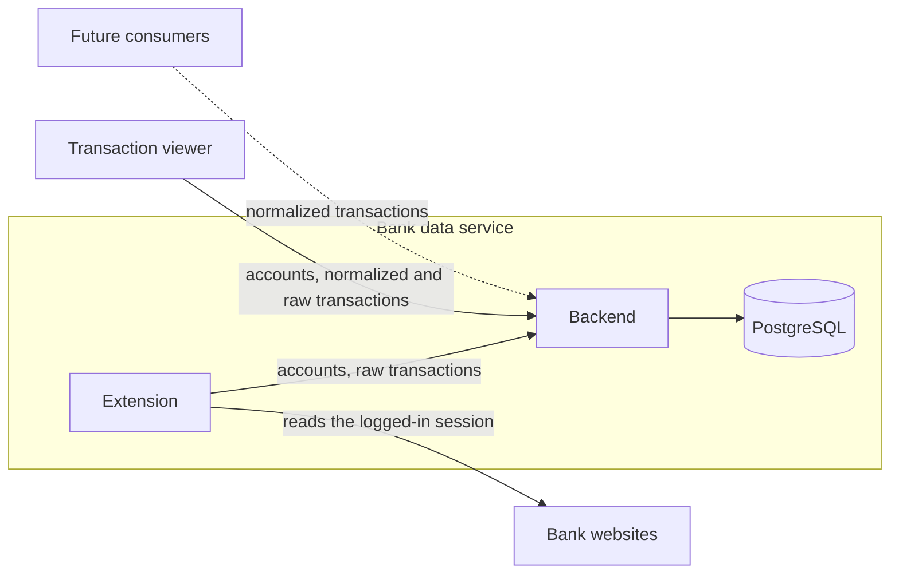
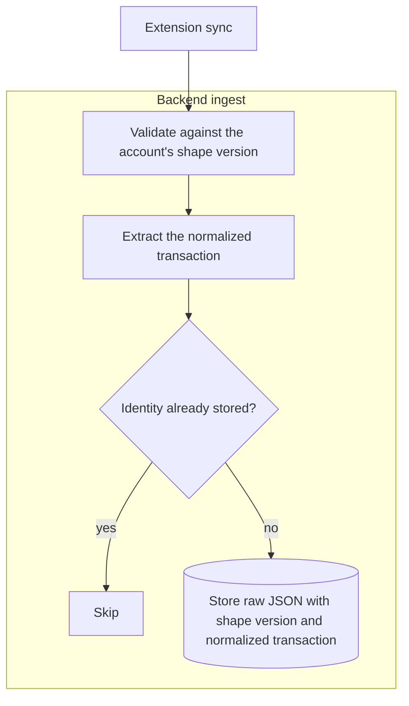
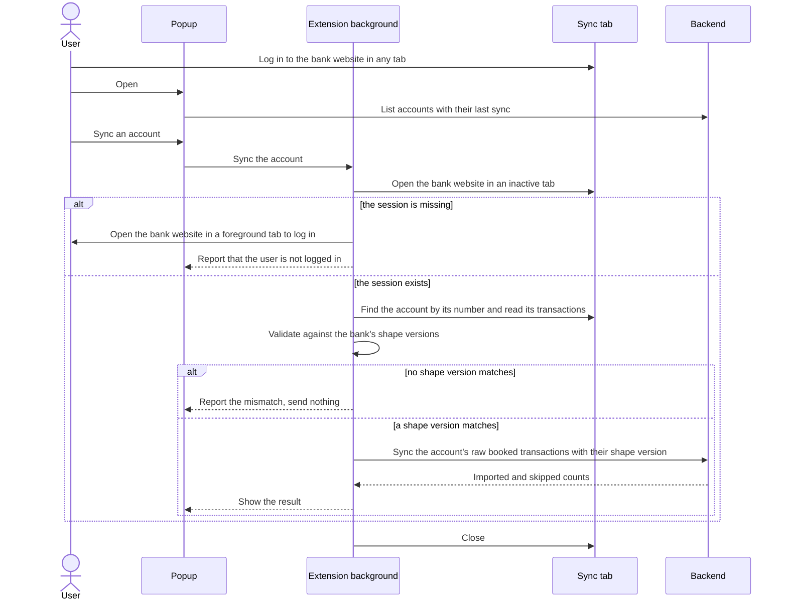
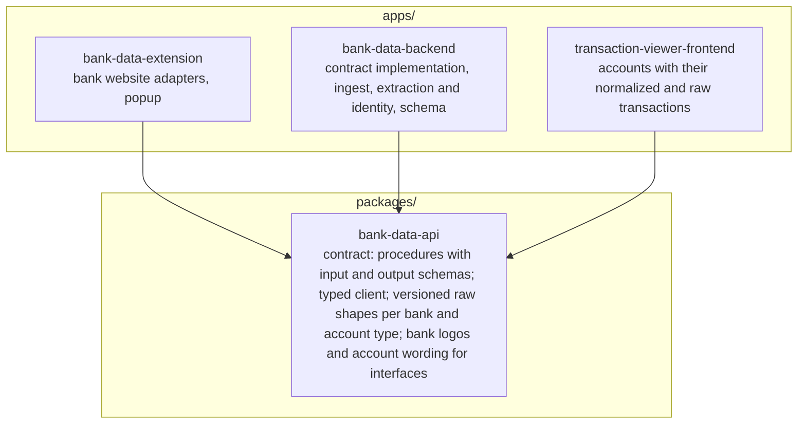
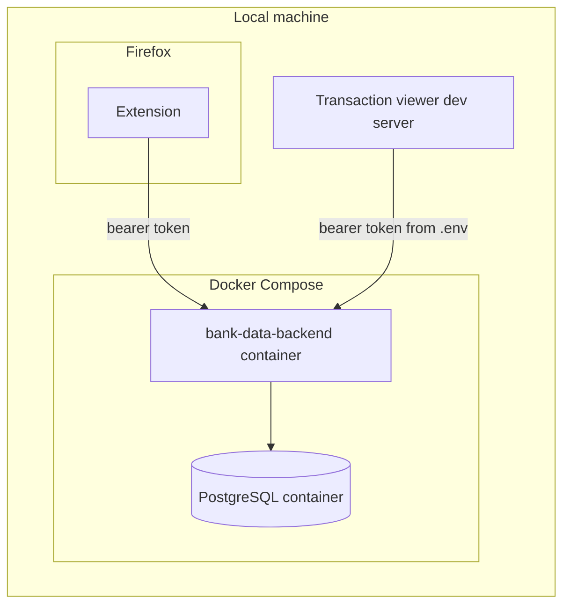

# Architecture

## System overview

The bank data service collects and serves the transactions; consumers, such as the transaction viewer and future finance logic backends, are services of their own.

- One user owns all data; the system manages no users and no permissions.
- The system never sees bank credentials, because the extension reads only sessions the user opened.
- Transaction data enters only through the extension.
- Consumers read transactions only through the backend's API, never from the service's database.
- The transaction viewer shows each normalized transaction beside its raw transaction, so the user can check extraction against what the bank delivered.

## Components

| Component | Owns | Leaves to others |
| --- | --- | --- |
| Backend | the API contract's implementation; validation, deduplication, raw storage and extraction; serving transactions to consumers | state outside PostgreSQL; opening balances, balances and holdings |
| Extension | one adapter per bank website; shape validation; the popup that creates, renames and removes accounts, lists them by bank with their last sync, and syncs each one | storing bank credentials |
| PostgreSQL | accounts; transactions, each row holding a raw transaction and its normalized transaction | |

The extension exists because a web page cannot read banking sites in the user's session: the same-origin policy and the banks' framing bans block it.
Why the extension is the service's only interface, and consumers own balances, is recorded in [ADR 0005](./adr/0005-bank-data-service-with-the-extension-as-its-interface.md); why consumers may read raw transactions too, in [ADR 0010](./adr/0010-consumers-read-raw-transactions.md).
Why every account takes the extension is decided in [ADR 0003](./adr/0003-ingestion-through-the-extension-only.md).

## Raw data and shape versions

- Each adapter reads one or more of its bank's exports, such as Deutsche Bank's CSV export for the cash account and its JSON transactions for the depot.
- A raw transaction is read by its account's bank and account type, which never change, and by its shape version; shape versions count per bank and account type, and a format change within an export or a switch to another export adds one beside the existing ones; why no transaction stores a source is recorded in [ADR 0011](./adr/0011-raw-transactions-read-by-their-account.md).
- Every raw transaction is stored as JSON together with the shape version it was validated against and its normalized transaction, and the raw JSON never changes afterwards.
- Removing an account deletes its raw transactions with it.
- A shape version's definition and extraction stay in the code as long as stored raw data follows it.
- Only booked transactions are imported, because pending ones change amount, date or ID when they book.
- An account's raw transactions are what its bank delivers for it, so a trade or dividend is a raw transaction of both the depot and the account it settles on; a trade carries opposite amounts in the two, so it cancels when adding up across accounts, and a dividend counts only in the account it settles on.
- A transaction's identity is the bank's own ID where the raw transaction carries one, otherwise a hash of stable fields with an occurrence counter for identical same-day entries; identities are always scoped to the account.
- Extraction turns a raw transaction into a normalized transaction and handles each bank's quirks.
- The type codes extraction depends on, such as the Deutsche Bank depot's `subType`, belong to their shape version, so an unknown code is a shape mismatch rather than a wrong normalized transaction.
- Re-extracting normalized data from stored raw data stays possible by design and is built only once needed.
- Database columns live in the backend's schema.

## Normalized transactions

- A normalized transaction carries a date, an amount with its currency, a counterparty and a description wherever the raw transaction has one.
- Its date is the booking date where the raw transaction has one, otherwise the transaction date.
- A depot transaction also carries the security's ISIN and name and the signed change in shares, which stays empty when no shares moved, such as for a dividend.
- A depot transaction's amount is the change in the money invested in the depot: a purchase adds what it cost, fees included, a sale subtracts what it paid out, and income, its reinvestment and charges paid by selling shares get none, as [ADR 0012](./adr/0012-depot-amounts-as-invested-money.md) records; every other account's amount is the cash the transaction moved.
- A normalized transaction carries no balance, because consumers derive an account's balance or a depot's invested money and holdings from its transactions.

## Ingestion

Ingest runs synchronously within the sync request, so the caller receives the imported and skipped counts.

## Extension sync

- A sync reads one account and needs a bank session the user opened in the same Firefox, which banks end after a few minutes without activity.
- A sync reads the full history the bank offers and relies on skipped identities for the overlap, so the extension keeps no state between syncs.
- A mismatch means the bank changed its format and the adapter needs a new shape version.

## Repository layout

- Each directory under `apps/` and `packages/` starts with the name of the service it belongs to, such as `bank-data-`.
- Code used by more than one app lives under `packages/`, and code used by one app lives in that app.
- No app depends on another app, and an app of another service depends on the bank data service only through `packages/bank-data-api`.

## API contract

- The extension and the transaction viewer call the backend through contract-first typed RPC.
- `packages/bank-data-api` defines each procedure's name with its input and output schemas, and the typed client both call the backend with.
- The backend implements the contract.
- Consumers pull every account's transactions with one `transaction.list` call, without a cursor or push, because the whole history is about 1,200 rows.
- The RPC library must support contract-first definitions, which rules out plain tRPC because it derives the contract from the implementation.

## Hosting and security

- Everything runs on the user's machine now; the same containers move to a self-hosted Kubernetes cluster later, and that move adds the manifests and decides whether Docker Compose stays.
- Kubernetes compatibility means the backend keeps no state outside PostgreSQL, every app reads its configuration from environment variables, and each container serves one app.
- Every backend request carries a bearer token that the backend reads from its environment; the user enters it once in the extension's popup.
- The transaction viewer runs only as a Vite dev server on the user's machine, whose proxy adds the token from `.env` to its backend requests, so the token never reaches the browser.

## Technology

- All components are written in TypeScript, so bank shapes and the API contract each have one home; the backend runs on Node.js.
- Frameworks and libraries are picked when each component is built and live in its code.
