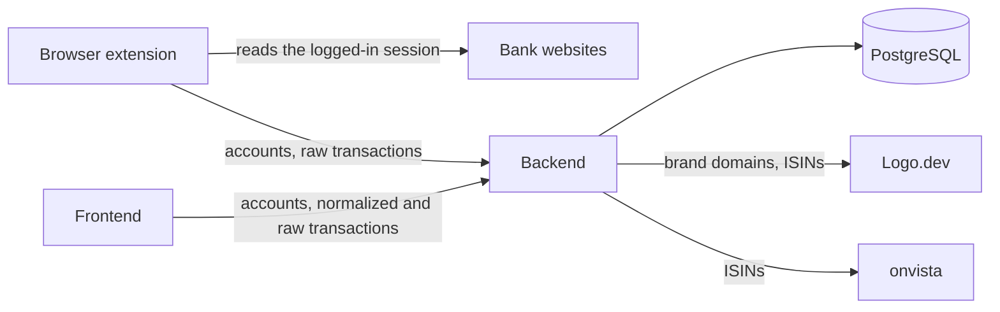
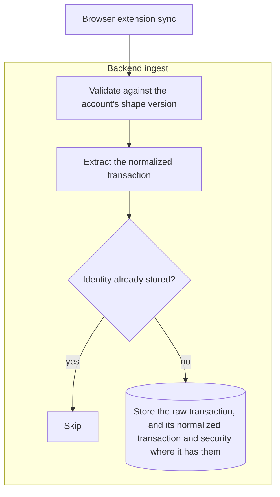
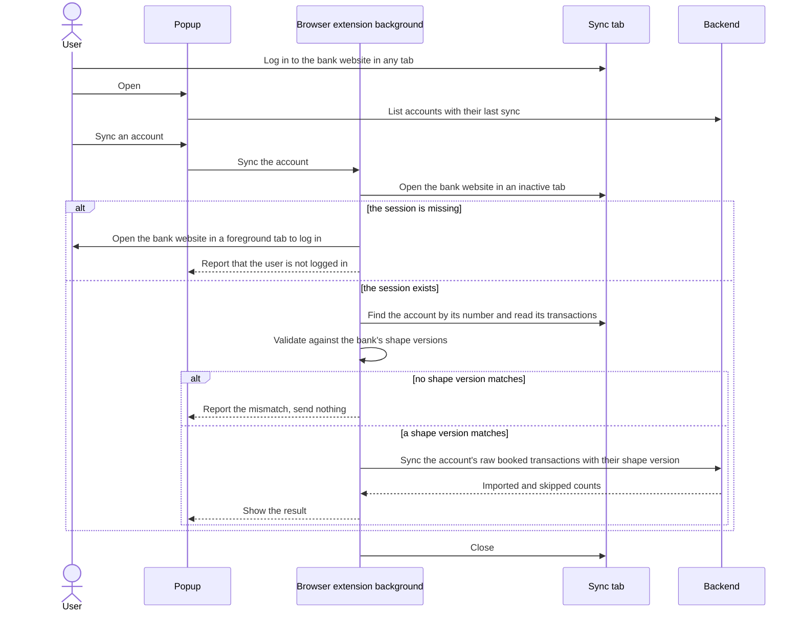
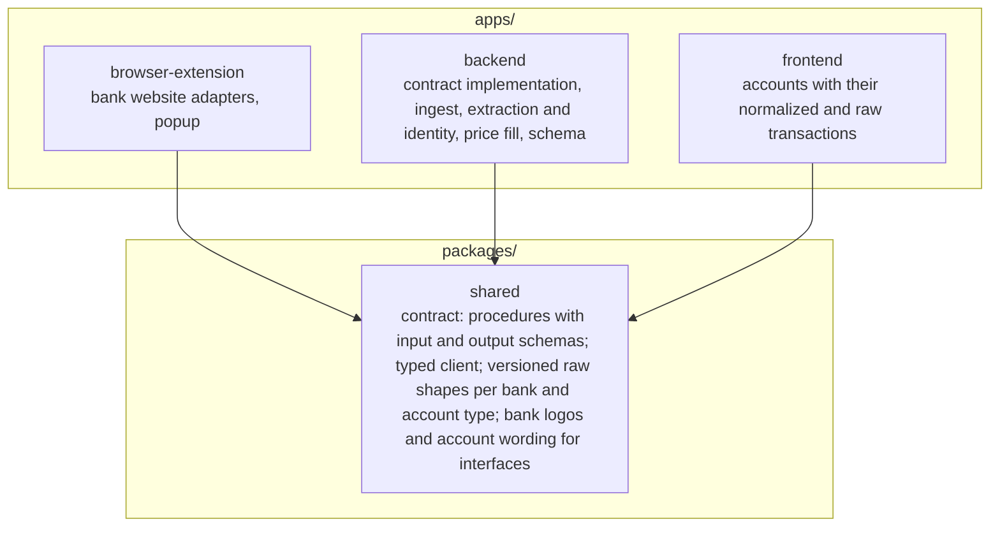
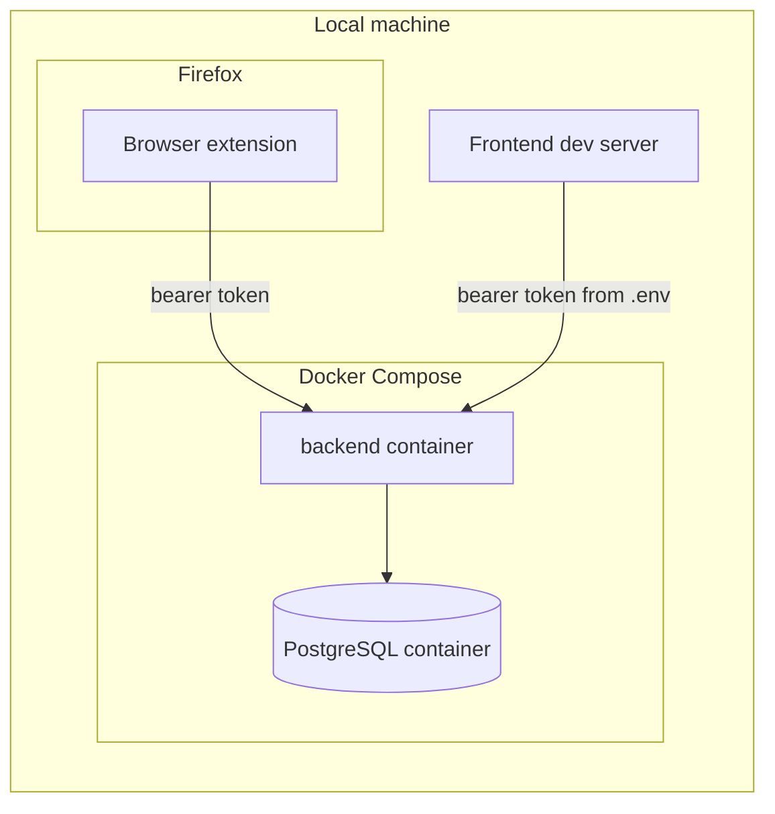

# Architecture

## System overview

- One user owns all data; the system manages no users and no permissions.
- The system never sees bank credentials, because the browser extension reads only sessions the user opened.
- Transaction data enters only through the browser extension.
- The frontend and the browser extension reach data only through the backend's API, never from its database.
- The backend's outbound services are Logo.dev, which receives brand domains and ISINs to return their logos, and onvista, which receives ISINs to return their daily prices; neither sees transaction data.
- The backend downloads each logo once through Logo.dev's API and stores it, because Logo.dev's terms allow storing what its API returns but only embedding what its CDN serves.
- The backend serves stored logos at `/logos/<id>` beside its oRPC API, because an `` loads a URL and cannot call a procedure.
- The frontend shows each raw transaction beside its normalized transaction, or marked as not extracted where it has none, so the user can check extraction against what the bank delivered.

## Components

| Component | Owns | Leaves to others |
| --- | --- | --- |
| Backend | the API contract's implementation; validation, deduplication, raw storage and extraction; every piece of data the system stores, logos downloaded from Logo.dev and prices from onvista included | reading bank websites |
| Frontend | the interface in which the user views and manages everything, so far each account with its normalized and raw transactions and its balance, or for a depot its invested money and market value | reading bank websites |
| Browser extension | one adapter per bank website; shape validation; the popup that creates, renames and removes accounts, lists them by bank with their last sync, and syncs each one | storing bank credentials |
| PostgreSQL | the tables of the [data model](./data-model.md) and the rules that keep their data sound | |

The browser extension exists because a web page cannot read banking sites in the user's session: the same-origin policy and the banks' framing bans block it.
Why the system is these three apps is recorded in [ADR 0014](./adr/0014-one-backend-one-frontend-and-a-browser-extension.md).
Why every account takes the browser extension is decided in [ADR 0003](./adr/0003-ingestion-through-the-extension-only.md).

## Raw data and shape versions

- Each adapter reads one or more of its bank's exports, such as Deutsche Bank's CSV export for the cash account and its JSON transactions for the depot.
- A raw transaction is read by its account's bank and account type, which never change, and by its shape version; shape versions count per bank and account type, and a format change within an export or a switch to another export adds one beside the existing ones; why no transaction stores a source is recorded in [ADR 0011](./adr/0011-raw-transactions-read-by-their-account.md).
- Every raw transaction is stored as JSON together with the shape version it was validated against, and never changes afterwards.
- Removing an account deletes its raw transactions and their normalized transactions with it.
- A shape version's definition and extraction stay in the code as long as stored raw data follows it.
- Only booked transactions are imported, because pending ones change amount, date or ID when they book.
- An account's raw transactions are what its bank delivers for it, so a trade or dividend is a raw transaction of both the depot and the account it settles on; a trade carries opposite amounts in the two, so it cancels when adding up across accounts, and a dividend is income in the depot and money on the account it settles on.
- A transaction's identity is the bank's own ID where the raw transaction carries one, otherwise a hash of stable fields with an occurrence counter for identical same-day entries; identities are always scoped to the account.
- Extraction turns a raw transaction into a normalized transaction and handles each bank's quirks.
- The type codes extraction depends on, such as the Deutsche Bank depot's `subType`, belong to their shape version, so an unknown code is a shape mismatch rather than a wrong normalized transaction.
- Re-extracting normalized data from stored raw data stays possible by design and is built only once needed.
- The [data model](./data-model.md) shows the tables and the rules the database enforces, and their columns live in the backend's schema.

## Normalized transactions

- A normalized transaction is a cash transaction or a depot transaction, and the [data model](./data-model.md#normalized-transactions) states what each holds.
- Its date is the booking date where the raw transaction has one, otherwise the transaction date.
- Its counterparty and description are filled wherever the raw transaction has one.
- A normalized transaction carries no balance, because an account's balance and a depot's invested money and holdings add up from its transactions.

## Ingestion

Ingest runs synchronously within the sync request, so the caller receives the imported and skipped counts.

## Browser extension sync

- A sync reads one account and needs a bank session the user opened in the same Firefox, which banks end after a few minutes without activity.
- A sync reads the full history the bank offers and relies on skipped identities for the overlap, so the browser extension keeps no state between syncs.
- A mismatch means the bank changed its format and the adapter needs a new shape version.

## Repository layout

- Code used by more than one app lives under `packages/`, and code used by one app lives in that app.
- No app depends on another app.

## API contract

- The browser extension and the frontend call the backend through contract-first typed RPC.
- The API serves these two apps alone and changes together with them, without versioning or compatibility promises, as [ADR 0014](./adr/0014-one-backend-one-frontend-and-a-browser-extension.md) decides.
- `packages/shared` defines each procedure's name with its input and output schemas, and the typed client both call the backend with.
- The backend implements the contract.
- The frontend pulls every account's transactions with one `transaction.list` call and every stored price with one `price.list` call, without a cursor or push, because they are about 1,200 and 1,800 rows.
- `transaction.list` serves every raw transaction with its cash or depot transaction, or with neither where extraction yields none.
- `price.fill` fills the prices every holding span lacks and answers how many it stored, or, after trying every security, fails with `BAD_GATEWAY` naming each security that failed and why.
- The RPC library must support contract-first definitions, which rules out plain tRPC because it derives the contract from the implementation.

## Hosting and security

- Everything runs on the user's machine now; the same containers move to a self-hosted Kubernetes cluster later, and that move adds the manifests and a CronJob that calls `price.fill` once a day, and decides whether Docker Compose stays.
- Kubernetes compatibility means the backend keeps no state outside PostgreSQL, every app reads its configuration from environment variables, and each container serves one app.
- Every backend request carries a bearer token that the backend reads from its environment; the user enters it once in the browser extension's popup.
- The frontend runs only as a Vite dev server on the user's machine, whose proxy adds the token from `.env` to its backend requests, so the token never reaches the browser.

## Technology

- All components are written in TypeScript, so bank shapes and the API contract each have one home; the backend runs on Node.js.
- Frameworks and libraries are picked when each component is built and live in its code.
