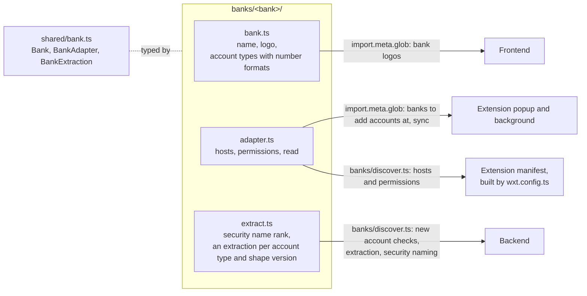

# Banks

Every app finds the bank folders by these file names, so a folder added or removed changes what the apps offer without a change to the apps.
A bank's identity rule comes from its extraction, and [`banks/identity.ts`](../../banks/identity.ts) turns it into the identity the backend stores, as [Ingestion](./ingestion.md#adapters) shows.
