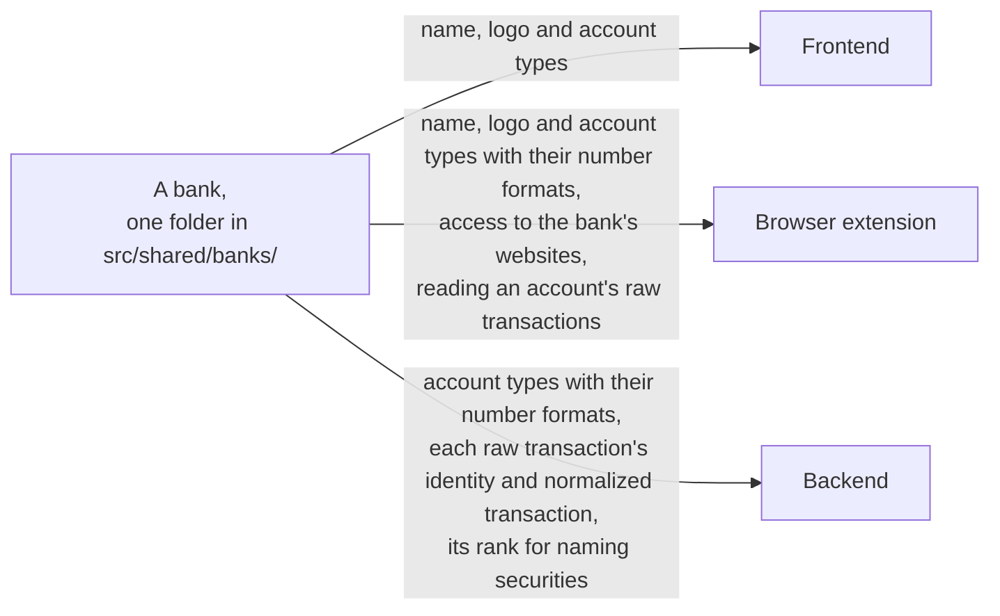

# Banks

Every app takes each bank folder there is, so adding or removing a bank's folder changes no app, only the checks in the [schema](../../src/backend/schema.sql) that list the known banks.
A bank declares only the account types the browser extension syncs, so the popup lists, and the frontend marks with a sync's freshness, only accounts of a declared type.
A bank the extension doesn't sync, such as Sparkasse, has no adapter and declares no account type, and its data enters [by hand](./ingestion.md#by-hand).
