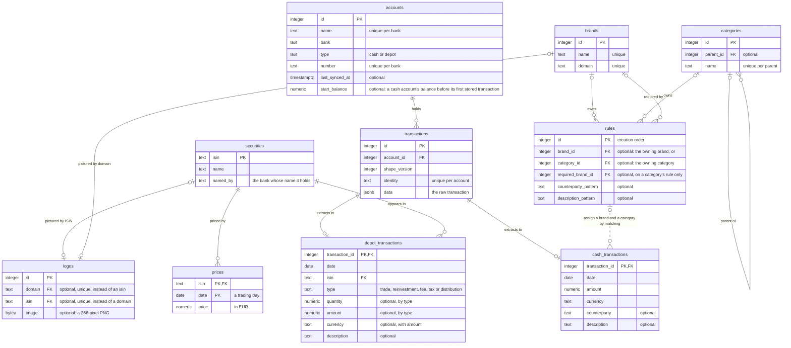

# Data model

Every column is required unless the diagram marks it optional.
A dotted line has no foreign key: the backend matches the rows when it reads them.
The [schema](../../src/backend/schema.sql) holds the constraints and triggers, and the migrate step brings the database to it before the backend starts, as [Hosting](./hosting.md) shows.
