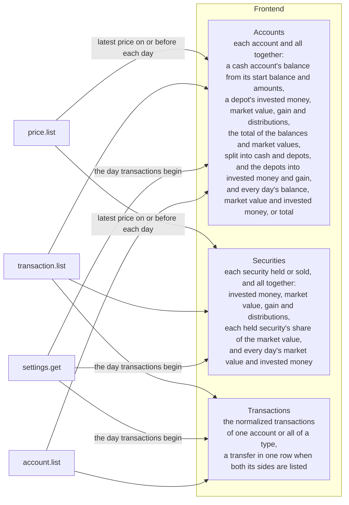

# Figures

The frontend adds up every figure in the browser from these lists, so the API serves no figures.
Where the settings name a day transactions begin, the Transactions view lists only transactions from that day on, and every chart begins on it with the values carried over from before, while every other figure counts every transaction.
