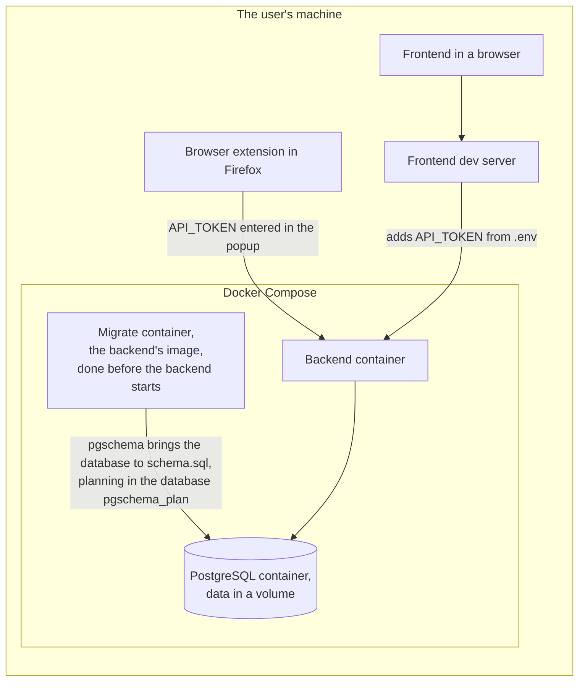

# Hosting

Compose publishes PostgreSQL and the backend on `127.0.0.1` only, and the backend answers only requests that carry `API_TOKEN` as bearer token.

Any other deployment, such as a Kubernetes cluster, runs the migrate step from the backend's image to completion before the backend starts, as an init container of a single backend pod or as a job before the rollout, never twice at once, with a database role allowed to create `pgschema_plan`.
