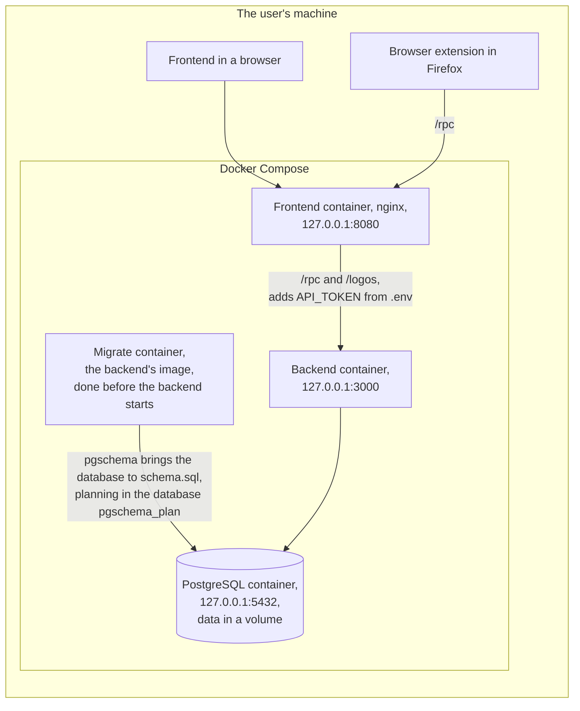
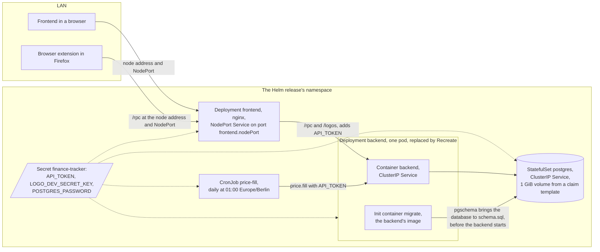
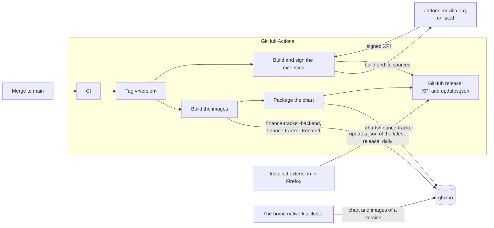

# Hosting

The backend answers only requests that carry `API_TOKEN` as bearer token.
The frontend's nginx adds it to every request it forwards to the backend, so whoever reaches the frontend's port reads and changes all data.
The browser extension sends its requests to the address entered in its popup: the frontend's origin, whose nginx replaces the extension's token with its own, or the backend's port with the token entered there.

## Docker Compose on the user's machine, for tests

During development, the frontend's dev server takes nginx's place and adds the token the same way.

## The K3s cluster of the home network, in production

The chart [`chart/`](../../chart/) deploys one release per namespace under fixed resource names, with `frontend.nodePort` as the one value a deployment sets, which Kubernetes picks when unset.
It reads the Secret `finance-tracker`, which the deployment provides; the backend's database URL holds `POSTGRES_PASSWORD` unescaped, so it must be URL-safe.
A NetworkPolicy admits connections to PostgreSQL only from the backend's pod, so the frontend's NodePort is the one way into the release from outside the cluster.

## Releases

Every merge to `main` releases all artifacts under one version, which [`release.yml`](../../.github/workflows/release.yml) derives from the last `v*` tag and the merge's Conventional Commit subject.
