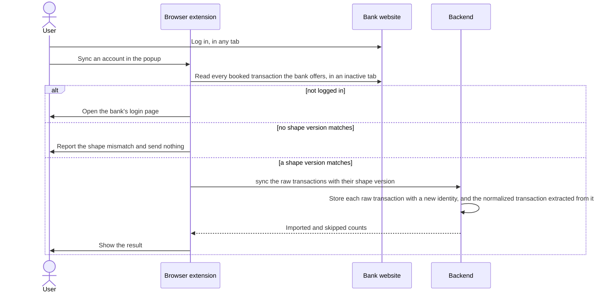
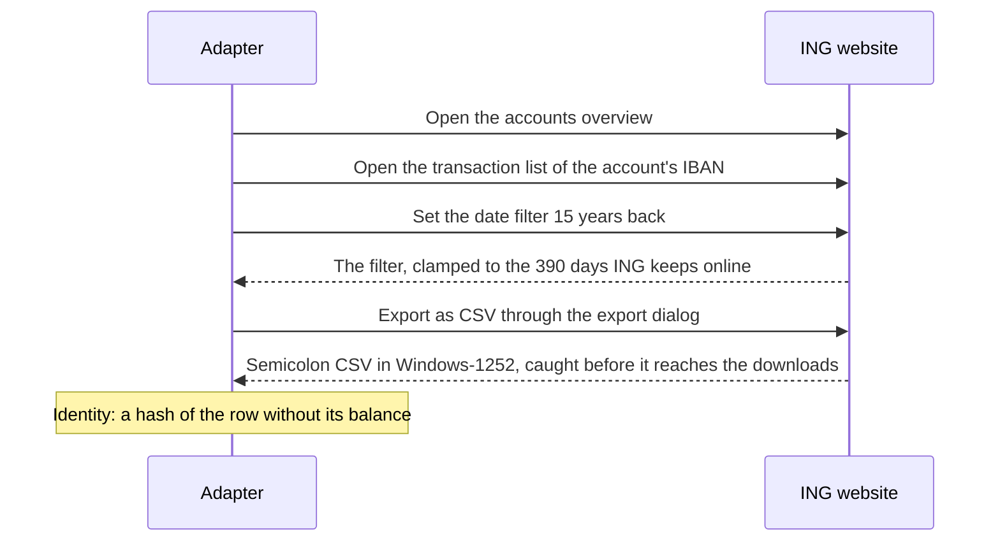
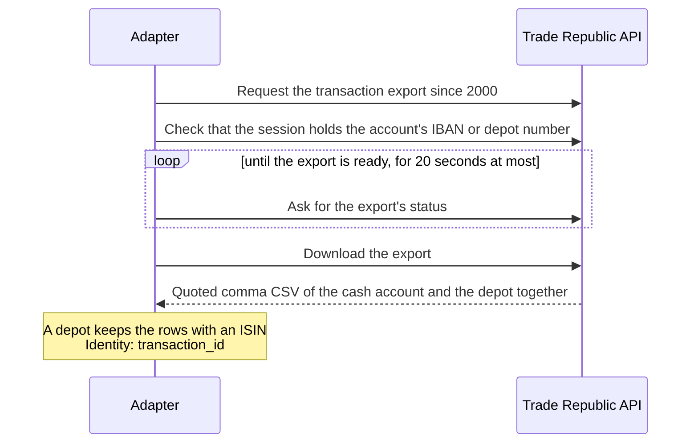
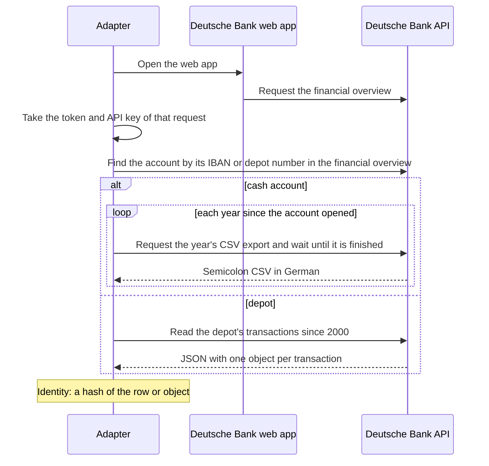
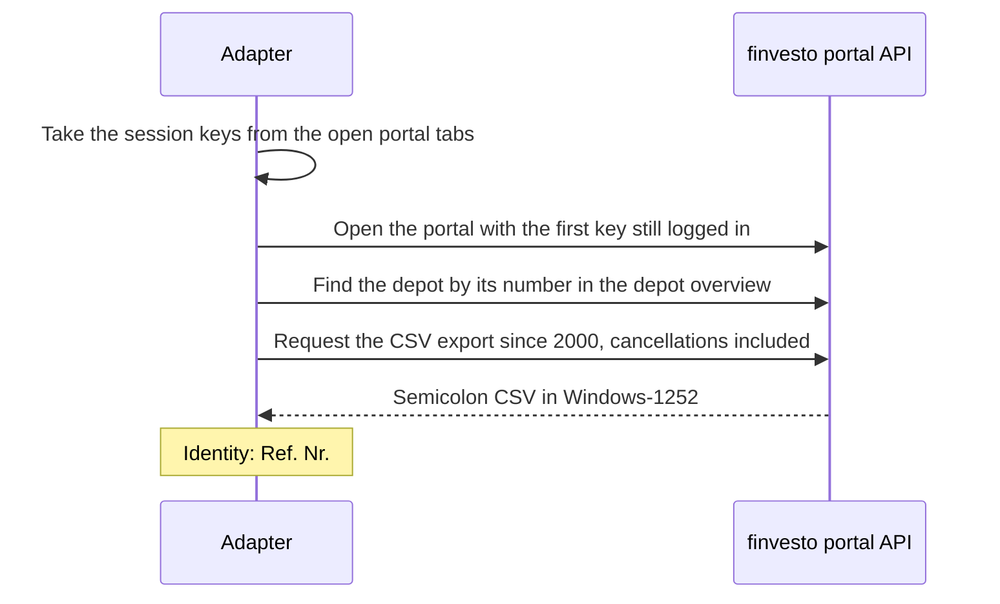

# Ingestion

## Sync

A sync leaves the overlap with earlier syncs to the identities already stored, so the browser extension keeps no state between syncs.

## Adapters

Each bank is a folder in [`banks/`](../../banks/), as [Banks](./banks.md) shows, with its adapter, its extraction and its shape versions, one for each structure in which it has delivered an account type's raw transactions.
An adapter reads the account in an inactive tab within the user's session, and sends every row or object its bank delivers as one raw transaction.
Where a diagram calls a bank's API, the adapter calls it from within the bank's page, so that the session authenticates the call.

### ING

### Trade Republic

### Deutsche Bank

### finvesto

