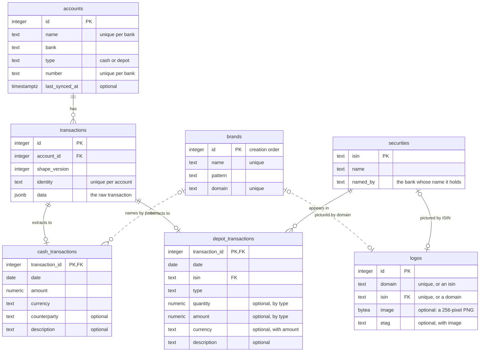

# Data model

The backend stores each transaction once with its raw transaction, gives cash accounts and depots a table each for the normalized transactions extracted from it, and lets the database itself reject data that makes no sense; why is recorded in [ADR 0013](./adr/0013-normalized-transactions-per-account-type-checked-by-the-database.md).

Every column is required unless the diagram marks it optional, and an optional column without a value is `NULL`.
A security holds the fullest name a bank delivered for its ISIN: finvesto's before Deutsche Bank's before Trade Republic's.

## Normalized transactions

- A normalized transaction belongs to the account of its transaction, so a trade's cash side is a cash transaction of the account that paid, wherever [its bank delivers one](./architecture.md#raw-data-and-shape-versions).
- A raw transaction is extracted to at most one normalized transaction, and one that moves neither money nor shares, such as finvesto's notice of a charge, to none.
- A cash transaction's amount is the change of the balance, fees and taxes included, and its date the day the balance changed, such as a card purchase's booking date rather than its purchase date.
- A normalized transaction's counterparty and description hold its bank's text as delivered, such as ING's `VISA ` prefix or the line breaks in its remittance text, so tidying them is not extraction's job.

## Depot transaction types

| Type | Holds | `quantity` | `amount` |
| --- | --- | --- | --- |
| `trade` | a buy or a sale | not 0: above for a buy, below for a sale | the quantity's sign: what the buy cost, fees included, or what the sale paid out |
| `reinvestment` | shares bought with a distribution that stays in the depot | above 0 | `NULL` |
| `fee` | shares sold to pay a fee | below 0 | `NULL` |
| `tax` | shares sold to pay a tax | below 0 | `NULL` |
| `distribution` | income a security pays, such as a dividend, a fund distribution or a stock perk | `NULL` | above 0: what was paid, after taxes |

- A depot's shares of a security add up from the quantities of its depot transactions.
- A depot's [invested money](./adr/0012-depot-amounts-as-invested-money.md) adds up from the amounts of its trades alone, because a distribution's amount is income.

## Brands

- The user inserts brands into `brands` by hand, each with its name, its website's domain and a pattern in PostgreSQL's regular expression dialect.
- A cash transaction's brand is the earliest-created brand whose pattern matches its counterparty regardless of letter case, found anew on every read, so a brand covers the whole history from the moment it is stored.

## Logos

- A logo belongs to what Logo.dev was asked for, a brand's domain or a security's ISIN, so a brand finds its logo by its domain and a security by its ISIN.
- Every read of the transactions first downloads the logo of each domain and ISIN without a `logos` row; a row without image records that Logo.dev knows no logo, and a failed download stores nothing, so the next read retries.
- A brand whose domain changes finds no logo until the next read downloads the new domain's, and the old domain's row stays unused.

## Database rules

The database enforces each of these, so no writer can store a row that breaks one; the [schema](../apps/backend/src/schema.ts) holds the constraints and the [migration](../apps/backend/drizzle/0000_init.sql) the triggers.

- A depot transaction has one of the five types, its quantity and amount follow that type as the [types table](#depot-transaction-types) states, and it has a currency exactly when it has an amount.
- A trigger lets a cash transaction reference only a cash account's transaction and a depot transaction only a depot's, so no transaction has both.
- A trigger keeps a row of `transactions` unchanged, so a raw transaction stays as its bank delivered it.
- An account's type is cash or depot and its bank one the system knows, and a trigger keeps both unchanged, because [they decide how its raw transactions are read](./adr/0011-raw-transactions-read-by-their-account.md).
- A cash or depot transaction's amount has exactly two decimals, so a bank's sub-cent amount fails its sync instead of being rounded.
- A security is named by a bank the system knows.
- A currency is three capital letters, and an ISIN is two letters, nine letters or digits, and one digit.
- A brand's name and domain are each unique, its domain is a lowercase bare hostname such as `rossmann.de`, and its pattern is a valid regular expression that does not match the empty string, so no brand matches every counterparty.
- A logo has exactly one of a domain, in a brand's format, and the ISIN of a known security, each unique, and its image and `etag` are set together.
- A text column never holds an empty string, so `NULL` is the only way to hold no value.
