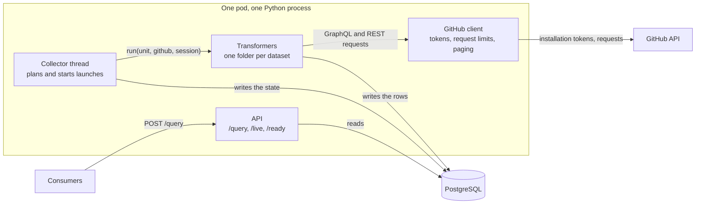
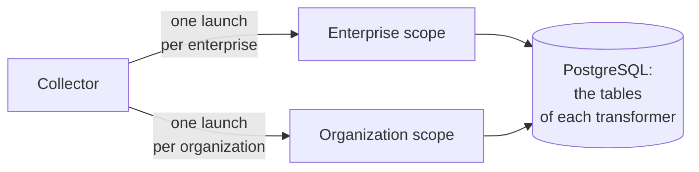
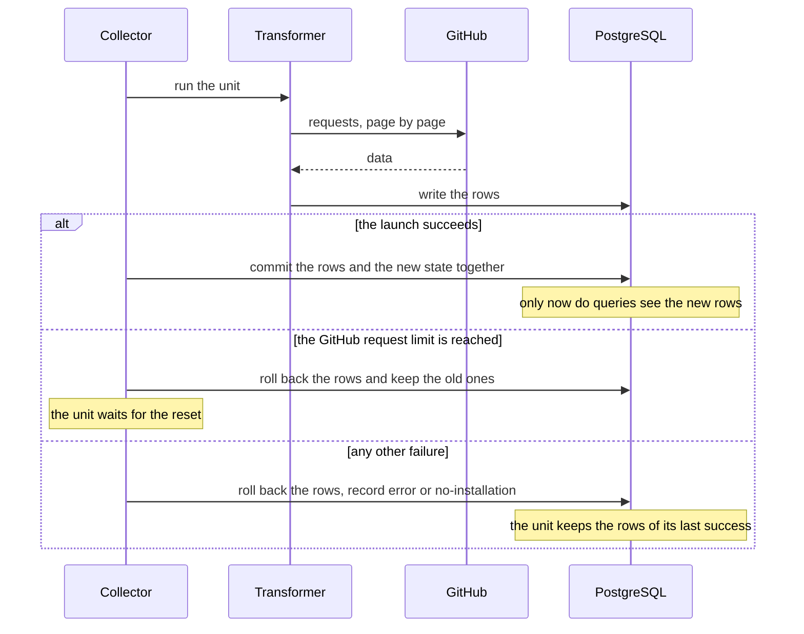
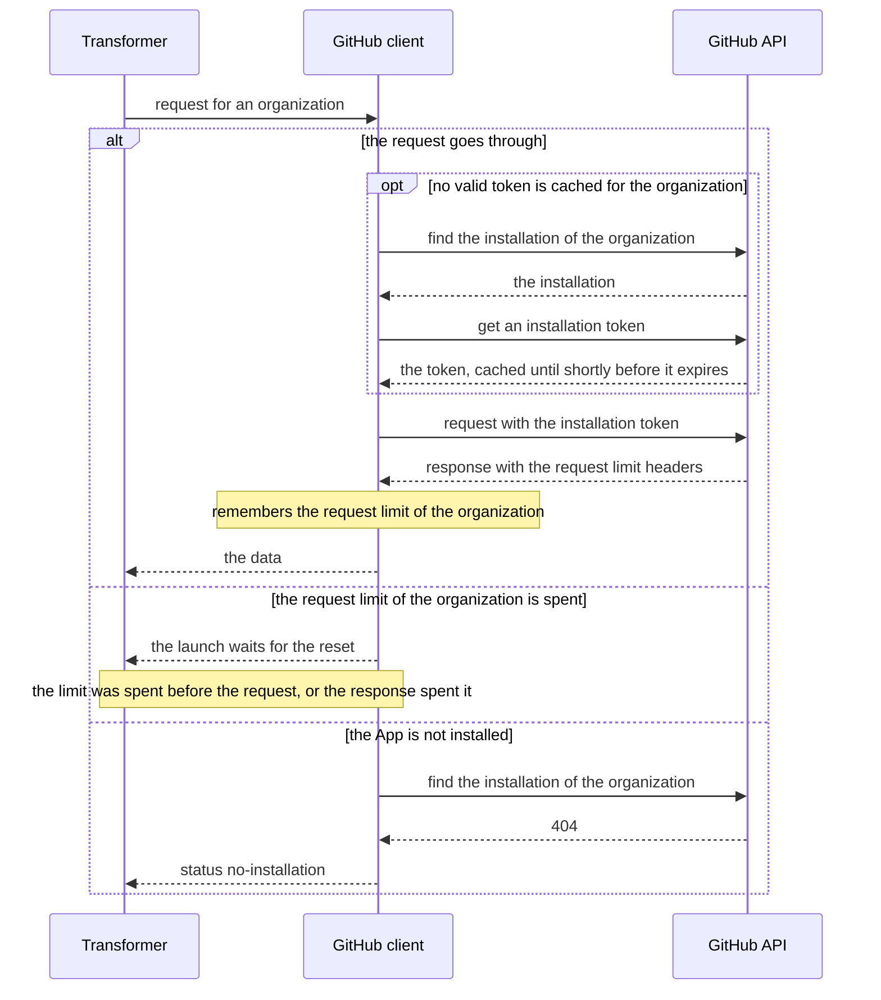
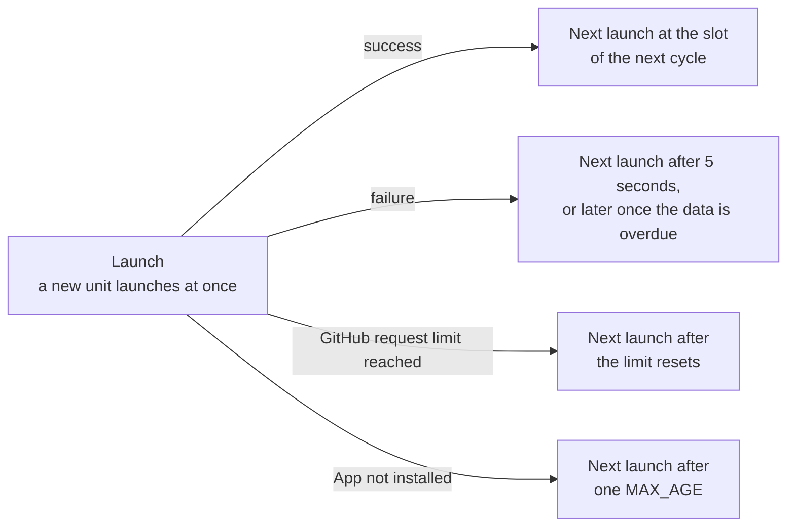
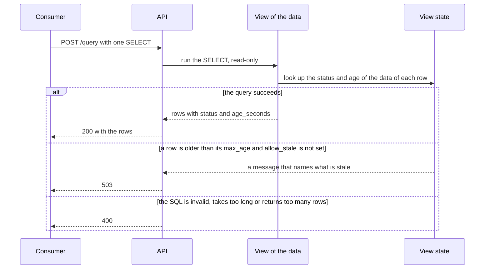
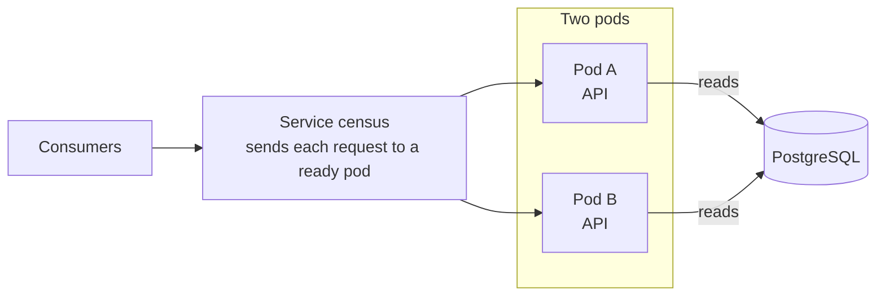
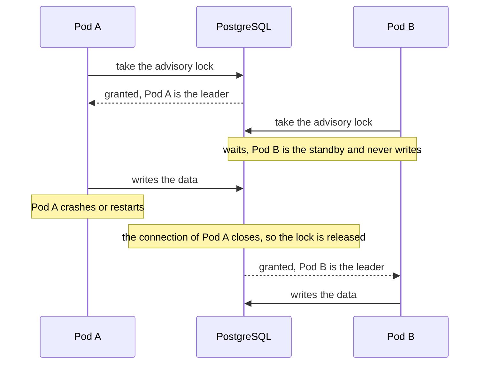
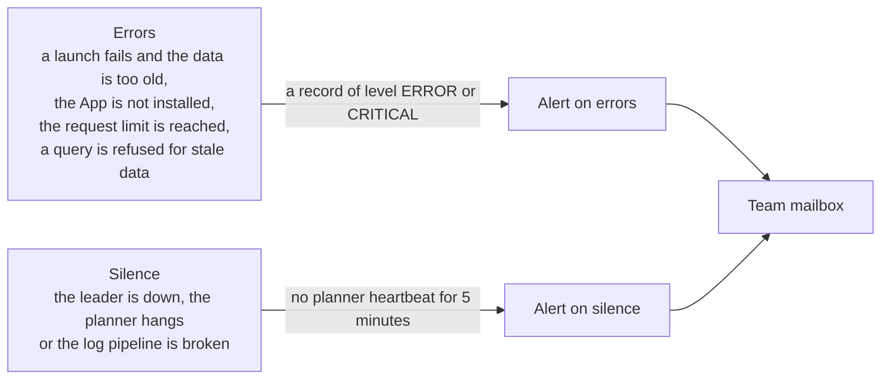

# Architecture

## Components

Every pod runs one Python process that serves the API and runs the collector on a thread.

<a href="https://mermaid.live/view#pako:H4sIAAAAAAACA3VSUUvDMBD-K0eeFCp7HzIQFRUGbs4360Pa3NpgmtTk4hjqf_fSdNqJBkIv5fvu7vvu3kXtFIq52Bq3q1vpCZYPpQU-tbMhdujDUykuD3EpnuHsbPFRitX95hFmrxH9vhQfIHudaSFWjZd9C71TzLy3mKICHAerPbXOQu9djSHlypR0mM_oi9XdeeVni5y3gJnRb8gfj1Ltj_C1MwZrcn7oboyB2oQcUvRG2gDSKgjEsgIYGW3d4nFZ8ozaOj_qfJw8hyyp660zCj30fJUkGZCOOzEaLTH5RtNtrMb3wCb3gjYU4JH1BAKjO0387mWjbfOdBa3KAZswuptkhOSrqp5O2GwXqPG4WS9Lcfp8mM9B9UiJ9iRaTQU0mtpYFRDYZO3sacozFfo3f-c1YWALMTlGmKtn7JQ9wm_SkNfLweGHa96FUeTQdfbgX-6klHe7MK2UmSNOW-7EGEmsAn6ZObCy0h_veX_YVVEILtZJrXix30vBdTqWMy-Fwq2Mhuf3yRgZyW32thZz8hELEXseL15pyfvb5Z-fX90oXSogAwAA">Open the diagram in full size</a>

## Transformers

A transformer collects one dataset and keeps it in tables of its own.
It lives in a folder under `census/transformers`.

A launch runs a transformer for one unit, which is the whole enterprise or one organization, and the scope of the transformer says which.
The effort of getting the data decides the scope: a few requests for everything make it enterprise scope, and requests per organization, each with the installation token of that organization, make it organization scope.

<a href="https://mermaid.live/view#pako:H4sIAAAAAAACA3WQTUsDMRCG_0qYk0KL90V6UW8FP3psephNZncD2cwymSDa9r-b1qpLwZzyhJfnnckeHHuCBrrI725AUbN-s8nU4zhGcsqytfDwc7ewM8vl6mCBE5mIJbnhvpW71URiKCnJJCGThcOMquDpF0x2PNXA7qrlfy1Ljyl8ogZOJ_Gcq_p5hlfyvxFOduPb7Y2FF87aC21e1825Qgcyim2kfEbuDKEbjAqm3LGMVJe-vQjn1RclLKBGRgy-_uLeQtWNdYLGgqcOS1QLx5rBorz5SA4alUILKJNHpceAveD4_Xj8AlsBBneNAQAA">Open the diagram in full size</a>

## Launch

The collector commits the rows together with the new state of the unit, or none of them, so a query never sees half a launch.

<a href="https://mermaid.live/view#pako:H4sIAAAAAAACA42TwW4iMQyGX8XKGV5gDr2ARA_VqqtynItJDETNxDR2OkJV373OzAK7opUWjYTm_-1fn53Mh_McyHVO6K1S9rSOeCg49Bnsd8Ki0ccTZoUVoMCKUyKvXO79bfO3BbPsuQz0TcWmVWyiPtbdvblu5jOLHgq9_H6aC1bLh4dtB6Vm0CNBzVFnY2vGxowGLSoLizoQ7M7T_1yyWc7NARVvTesOxhKVprzCo8wWJp2UhDX7I0j1nij8MS8k1ut5GKJemwFzmF4yjSCKLZcPZEq5tf5ik_mdClgA53SGzCMEBmMvkQSE6BpyQ6Ikszxv7DIrpNgIopiA_kjhjrHYGcEO_eu_mK9Ep0nhFAyD5DvCVXddNIwYVcAOc84hIf2LDPMZuA0Ke4ypFvoPjoWleC4BqBSLtSfzMmZbXEqokfMPS7sitRnkNhbvoSEmtLVMRyaX3eXgFs4u4YAx2OX-6J01DdS7rneB9liT9u7TarAqv5yzd52WSgtXT3ZfLh_BLH5-AQSHnt4kAwAA">Open the diagram in full size</a>

The state table keeps for every transformer and unit the status of the last launch, the time of its last success and the GitHub request limit that the launch saw.

## GitHub client

[`census/core/github.py`](../census/core/github.py) is the only place that sends requests to GitHub.
The client authenticates as the Census GitHub App with an installation token per organization and keeps the request limits, while a transformer decides what to ask and how to read the answer.

<a href="https://mermaid.live/view#pako:H4sIAAAAAAACA51US2_bMAz-K4TODtBDTz4UKDIg3WUYsBx9YWzGFipLnkQ1faD_fZRVJWmcPTDdbH38HiTtN9W6jlStAv2MZFv6orH3ODYW5EzoWbd6QsuwBQyw9WjD3vmR_BKxToiN5oe4g9ZosrzEbM4w99-_ZsB2dXe3rsEnC4FB-AEtON-j1a_I2tmMQ8PAAx2BvaMgL7yL_ZAR6biJwTp4QqM7YPdIFnSAFtuBupk7USzJy1mLmU0Ne227GaltYDRmRoLb_6V6s8pZLiuvavTEKegnhdnw7znn66qkiZa1gTA4z-YFdiTpRJaBniftKZxoyHanhw_10sWD5mGZ9MJH8SCsk7OBTlWFxuhRlAfCjvyZ8jfH0q8n8jBXjzTu5P5K5R9bu07y29yCDhnzDRkx8k9MaQPCdNzIS0qD0bYDHFBzOK6IRCW-GqQqZbPcAT-4ywDOHFVwIst9y0jNFwnupyl5tI7LGGg5sf_YyTK325vbZXQh4ZhEV8tVlY1RlZLvfETdyf_hrVGiMlKj6kZ1tMdouFHvgsHI7seLbVXNPlKl4iQTKv-R_PL9F_RUTY9nBAAA">Open the diagram in full size</a>

The client learns the request limit of each organization from the response headers.
A spent limit of the REST or GraphQL requests stops every launch of that organization until the reset, while a small limit of one feature, such as the SBOM reports, stops only the launch that uses it.

## Scheduling

Every transformer has a `MAX_AGE`, which is a promise: the data of a unit is replaced before it passes that age, and a query that reads older data is refused.
The planner starts the launch of each unit at its slot, so that the new data commits before the old data passes `MAX_AGE`.

<a href="https://mermaid.live/view#pako:H4sIAAAAAAACA3WRTUsDMRBA_8ow5xZPXooUCko9VA96EYzINJl1A9lkTSbW0va_m6QWRNqckvl4L5PsUAfDOMPOhY3uKQqsnpSHshxlr_tXhau2uVnHqzmB5w1kb-U3zQlIIHjNCt_-9sF0Ot8rTFlrTknhHpILUmiP_H1qrq3Sc8s0fOja2dcSvdXuArQj63LkCo0scfuf2glHuIbEOniTJkd0LOkar3dtFkNCYBOEL44mX1AtrdznddF8Zk7FYIcyemQqk5vqb4Fz_iatmlNLYknnHYtxBB8ErE9Czh3BPtA4XgQHz_CweHlfLO8KEyc4cBzImvKRO4VFO5R5ZgoNd5SdKDyUGsoSnrde40xi5gnmsTwB31r6iDQcg4cfecWUjhACAAA=">Open the diagram in full size</a>

- Each unit gets a fixed time in its cycle, which is `MAX_AGE` minus a margin, so the units of one transformer do not start together.
- The margin follows the measured duration of the unit and leaves room for three retries.
- A unit that keeps failing is retried slowly once its data is overdue, so it does not flood GitHub or the log.
- A request that cannot connect fails after 5 seconds, so launches that wait for an unreachable proxy cannot hold all 8 workers and starve the other units.

## Query path

A query cannot write: the database login of the API can only read, the transaction is read-only, and only one statement is accepted.
Every view of the data checks how old the data of each row is and refuses a row that is older than its `max_age`, unless the request sets `allow_stale`.

<a href="https://mermaid.live/view#pako:H4sIAAAAAAACA2WST2vcMBDFv8qg84aa_rn4EDBuDoFAUxz2ZFgGa7IrIo-20qjuEvLdO7LS1mV9kvV-782zrFczBUumNYl-ZOKJvjo8RpxHBn3OGMVN7ows0AMm6AOnPFO8lrsid4_318q-KHtHC4RnkBOBRcFrbPiLJUGhCvQ3t7ddC4_fhif4oAXjBRYnJwhMMNw93PVPleuU27cQM68TqrSDSGhvAvtLpfZKDS34EF4gn1eyzMoJkC3gkbYNy5pwOkEMS7Wjl1WtPVKeJiKbqlbja1s1pFrz__RDoinw1tEVR9_Cx6aphhJf7BUhnwiwbIBLELylqAQyOEkw469DqbyGex-Wg07zVEgOAonk35zhvRnCTCkVl8YIMOorLGWprtV-3e1L82nTZj3d7w-Fd_wTvbM7EHzRGAlBT5aPEKKeu-TIdW9Gvmy-aRv9uWneo9mandF7NaOzehlfR6ODZhpNOxpLz5i9jOZNGcwShgtPppWYaWfyWf_Vn0tbN99-A64xa3DUAgAA">Open the diagram in full size</a>

The statuses, limits and errors are in the [User guide](./user-guide.md), and the columns and the freshness of the views are in the [Data model](./data-model.md).

## Availability

Census runs as two identical pods in the GAP cluster.
Every pod answers queries, and only one pod collects and writes the data.

### Answering requests during restarts

<a href="https://mermaid.live/view#pako:H4sIAAAAAAACA2VQTWvCQBD9K8OcWlB6DyJYeyl4sKY3t4fZ3dEETDbdj4qo_72zJgqSOc2893jvMWc0zjIWuDu4o6nIR1htVAsyxrUhNezDVuHyviv8gel0DoH9X21YqLLfwLBIwkz7t3ng1gZgMhV4_k0cIkQHJAfZE3TOikufEZLee-qqDOac76O7rQ9BHhJi7SwsbuaL9ecTqwf2fcRKiyFlqJiL0xjSPUT5uCjMLaXABazevmTvEPeey6-VwtfBWY-lOEH5T0O1lWeeFcaKG1ZYKLS8o3SICq-ioRRdeWoNFtEnnmDqLEX-qEne0PTg9R8b7kPslAEAAA==">Open the diagram in full size</a>

- Every pod runs the whole API, so any ready pod can answer any query.
- A pod receives requests only once it is ready.
- A rolling update starts a third pod and stops an old one only when the new one is ready, so two pods stay available throughout.
- When the cluster drains a node, it never takes down the last pod.

### Only one pod writes

<a href="https://mermaid.live/view#pako:H4sIAAAAAAACA4WSwWrDMAyGX0X4nL5ADoWYHMfY6DUX1VZb08TuZKUllL77lJrAlsKWgw_S9__-JeduXPJkapPpa6ToqA14ZBy6CPpdkCW4cMEo0ABm-EgemtdeW3pZjky7z7dXwC5iW3rNZrttaxA8E8iJAP015MQT9MmdC9JulGlq0DRRyFflbgj5KegJPXEh7f9m70kI0pUYbKXoDYPk4mgXxywY_X4CPSHSjN44COVfgUvpyXsUXJtr3JLSMeaTgomBSZ1Z8pqdE6uNSzGSk5AipMOi7lMmzZdTmVXHmFMy6dSZ_I_92NV-7B_7WWU3lRmIBwxeX__eGa0P1Jm6M54OOPbSmYcyOEraTdGZWnikyowXFS9_SSk-vgGdbHCdRQIAAA==">Open the diagram in full size</a>

The collector of every pod asks PostgreSQL for the same advisory lock, which is a lock that PostgreSQL offers to applications, and the pod that holds it is the leader.
PostgreSQL ties the lock to the database connection that holds it, so a pod that crashes or restarts loses the lock at once, and the standby takes over within seconds.
Requests keep being answered during a takeover, but nothing launches until the standby leads, so a dataset with a short `MAX_AGE` can pass it, and queries on that dataset answer `503` until the next launch succeeds, as [Query path](#query-path) describes.

This is leader election: the lock has one holder until it lets go.
A launch that the former leader had already started can still commit once after the takeover, and the next launch corrects its rows.

## Alerting

The platform ships the logs of Census to Grafana Cloud, and two Grafana alerts email the team when something needs a human.

<a href="https://mermaid.live/view#pako:H4sIAAAAAAACA11SwW7CMAz9FSvnop12QRMSYhyQkCYVbus0uY1Lo6Vxl6ZjCPj3OS20aD3Fz-_Z7yU9q4I1qbkqLR-LCn2AbZo5kI-8Z9--Z2rdH15y_7RAsNi5ooISjW0BnYZQEWgMCKaFwAxsddJzY2PZNBF3HMC4NqC19ND19N1RG8Ca2oTI84RFdWcgSNefBrzsWtJQsoc4ZdiYqQ-YzRaXTKEwCvYauARLP2RhnaZvKQh9lW72m9Vym6kLiNCHzzHXMpbA7pZUxg3BW2PJFSSM3XAaDVtCTT460nx0SZ-9seicgBW6w3BJsrUn8wEa05A1jqIk9_xFbjLteNKSXHxOGPqEz1Ab1wVqJ8-TpdH0DRpdP4aLG6CWJ8r5VzR7wvpe_uPfpjwKVKJq8lJo-S3OmZIstayZZ0pTiZ0NmboKB7vAu5Mr1Dz4jhLVNfIm9Grw4LEewOsfOv1e1F4CAAA=">Open the diagram in full size</a>

- The planner of the leader logs a heartbeat once a minute, so the alert on silence fires when the heartbeat stops.
- Census sends nothing to Grafana itself, and the alerts are defined in the deployment repository.

## Logging

Census logs only through `logging`, as one line of JSON per record on stdout, so nothing writes to stdout or stderr directly.

### Levels and alerts

The level of a record is its alert contract: only a record of level `ERROR` or `CRITICAL` alerts, and it means that a human must act, as [Alerting](#alerting) describes.

| Level | Meaning | Examples |
|---|---|---|
| `CRITICAL` | An uncaught exception | `uncaught exception` |
| `ERROR` | A human must act | `launch failed` when the unit never succeeded or its data is already older than its `MAX_AGE`, `data overdue`, `app not installed`, `readiness check failed` |
| `WARNING` | Worth reading, never alerts | `launch failed` while a quick retry can still keep the promise, `workflow file skipped, it is not valid YAML` |
| `INFO` | Routine | `planner heartbeat`, `launch finished`, `query answered` |
| `DEBUG` | Details for a developer | `GitHub request`, `planned`, `query` with the SQL text |

The code and its tests are the list of the records and their levels.
