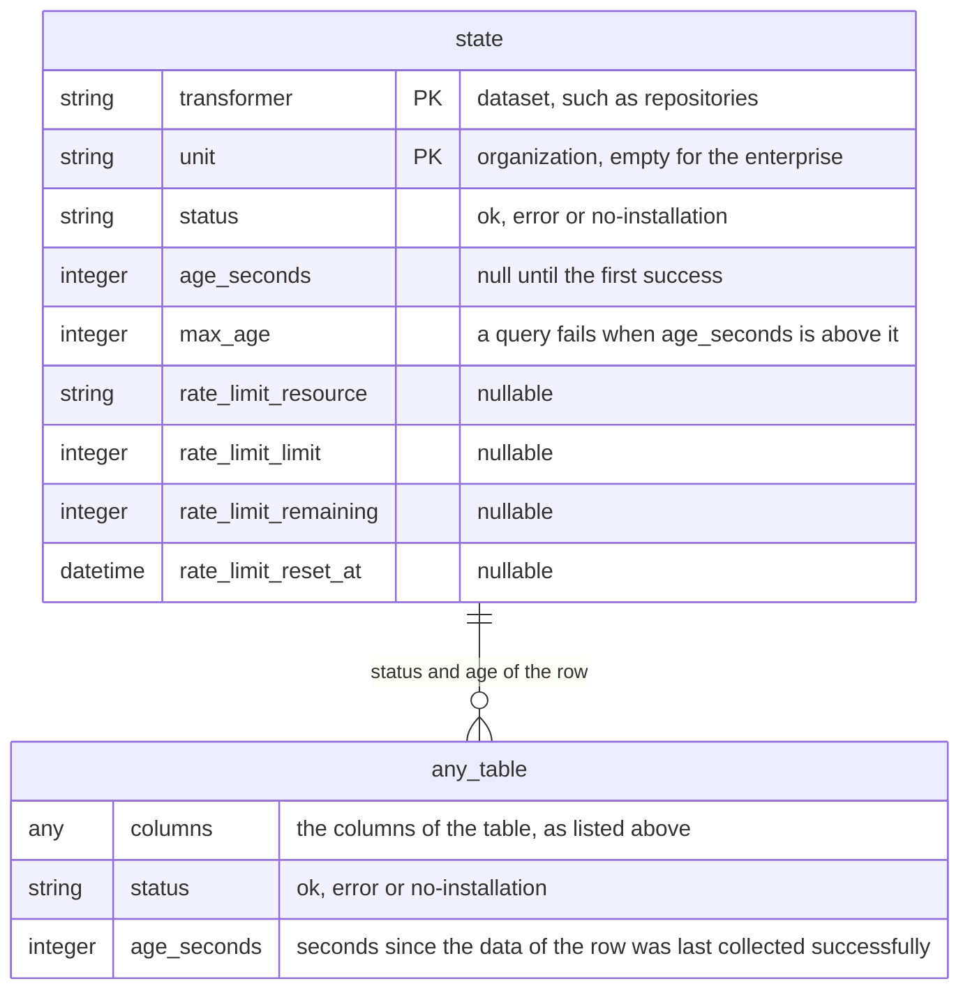

# Data model

A dotted line joins tables that are collected separately, so a row can name a repository that the other table does not list yet or any more.

```mermaid
erDiagram
    organizations ||--o| organization_settings : "slug = organization"
    organizations ||--o{ team_sys_apps : "slug = organization"
    organizations ||--o{ docs : "slug = organization"
    organizations ||--o{ repositories : "slug = organization"
    organizations ||--o{ repository_languages : "slug = organization"
    organizations ||--o{ repository_security : "slug = organization"
    organizations ||--o{ repository_sboms : "slug = organization"
    organizations ||--o{ team_sys_app_repositories : "slug = organization"
    organizations ||--o{ workflow_usages : "slug = organization"
    organizations ||--o{ workflow_schedules : "slug = organization"
    organizations ||--o{ teams : "slug = organization"
    teams ||--o{ team_members : "organization, slug = team"
    enterprise_teams ||--o{ enterprise_team_members : "slug = team"
    enterprise_teams ||--o{ enterprise_team_organizations : "slug = team"
    repositories ||..o{ repository_languages : "organization, name = repository"
    repositories ||..o{ repository_security : "organization, name = repository"
    repositories ||..o{ repository_sboms : "organization, name = repository"
    repositories ||..o{ workflow_usages : "organization, name = repository"
    repositories ||..o{ workflow_schedules : "organization, name = repository"
    repositories ||..o{ team_sys_app_repositories : "organization, name = repository"
    team_sys_apps ||..o{ team_sys_app_repositories : "organization, id = team_sys_app"
    organizations ||..o{ enterprise_team_organizations : "slug = organization"
    organizations {
        string slug PK
    }
    organization_settings {
        string organization PK, FK
        boolean projects_enabled
        boolean visible_by_internals
        string access_management_mode
    }
    team_sys_apps {
        string organization PK, FK
        string id PK
        string[] repos_include
        string[] repos_exclude
        string art "nullable"
        string business_criticality "nullable"
        boolean dora "nullable"
        string exposed "nullable"
    }
    docs {
        string organization PK, FK
        string slug PK
        string description "nullable"
        string repo
        string folder
        string ref
        string title
        boolean unlisted
        string[] exclude_tags
    }
    repositories {
        string organization PK, FK
        string name PK
        boolean archived
        boolean disabled
        boolean fork
        string[] topics
    }
    repository_languages {
        string organization PK, FK
        string repository PK
        string language PK
        bigint size
    }
    repository_security {
        string organization PK, FK
        string repository PK
        boolean secret_scanning_enabled
        boolean code_security_enabled
        string codeql_setup "default, advanced or none"
        boolean dependabot_alerts_enabled
        boolean dependabot_security_updates_enabled
    }
    repository_sboms {
        string organization PK, FK
        string repository PK
        text content
    }
    team_sys_app_repositories {
        string organization PK, FK
        string team_sys_app PK
        string repository PK
    }
    workflow_usages {
        string organization PK, FK
        string repository PK
        string path PK
        integer line PK
        string component PK
        string ref PK
        boolean opted_out
        string commit_sha
    }
    workflow_schedules {
        string organization PK, FK
        string repository PK
        string workflow PK
        string default_branch
        string cron PK
    }
    teams {
        string organization PK, FK
        string slug PK
        string name
    }
    team_members {
        string organization PK, FK
        string team PK, FK
        string login PK
        string role
    }
    enterprise_teams {
        string slug PK
        string name
    }
    enterprise_team_members {
        string team PK, FK
        string login PK
    }
    enterprise_team_organizations {
        string team PK, FK
        string organization PK
    }
```

<a href="https://mermaid.live/view#pako:H4sIAAAAAAACA7VYzW7bMAx-FcPndA8QYLdhl14K7LgMAi0xjjZZ8vTTNk367qNjO7FqOe3sNEeK_MSfj6ScQ86NwHydo_0mobRQbXRGP2NL0PIFvDTaZcfj3Z05RkLm0HupS5ets03uVCizr5HCJp9EOmQeoWJu7xjU9TwEYfg8Q4u1cdIbK3EhwJ4p0GWAcjmQQx6s9PvFOIWplleELc7Rk7F_tso8seBmp-eM4fgORVA4P7B3LVulYSoqrAq0reHQYpV1MI1Wb47ao62tdMgipDfyCHQBTBznBFhUw-Pxy5dr1I0j1FAhoV20P4gZsfhGkGdCL8BLsfEWcDExFyBeb74PAsczdQayFB2FeoOpvjohf5iU73fqoRU2P-ctLZW2xx7uW_nr2Oayfca2Qz3CWGXf7y86hTEKQWe1Nb-Re8dQQ6FQjDUepZN0woo9k02oGpQb3QWco3OsAk3EqiglrKJ1Grkdl-U_3e10qDIPI-nPXy0JyD2uQn9r4hyfk-cZWE9V0kGpJgV9aQYKRXBSN_Fx6mrJQTW9nbbosyaMheug-Ew-oUgodQk7bfZ5eYpoM5ALdBRCfTK96lyTsJFwa5RAm9DdjmReeoXjrAStpPNDlp1L1BWHeShdlIaoWeel4zQqHhLsB8t38jHFeiHdRD9saeol_PemlnzC8-GWmRfBBSpV1h49jlGW1K-Zky845dV5T93UqT5RhG7R03IArUl9esI0L--zL2O17rZG669qBl6oibwCtxCUX2UgHkFzaiRjM210uhuxRi2gMJ6BQntt3A1Uzy6FWoDHN0aJdJ529E1z6fHZU-Q0d7WfnKbsBi0yxEtRLOFf58nbR8VnELwGv4vkzSYq0WaK5nLKgJuqJi4Q_5OxbJOENTWNJmaCT8FVkgixg3TolwfQZ0TfX5Oe6Kc2YIWlJtiNHbenS0fUufViaSbsmJ_9M38-JafOlKHhlqytUbEjo2-Jw_ygpj5jDgt8n4B-72F47YI3ye3uyVd5hbYCKfJ1ftjkfkcPtU2-Po_STd7oQPDmx17zfO1twFXezr7uP5FW-PoP8UZkvS0RAAA=">Open the diagram in full size</a>

## Freshness of the data

Census collects the data of each organization on its own schedule, so rows differ in age.
Every table therefore has two more columns, `status` and `age_seconds`, which tell how current the row is, and the table `state` lists the collections.

<a href="https://mermaid.live/view#pako:H4sIAAAAAAACA7VTz86bMAx_FStn-gI977bLpF2RkD8w1FpIOttZ1_H13ecA1bqNwy5DCIGT3z_HLKHPA4VzIPnAOAnObQK_1NAI3t9Pp7wApntn-BYJztCGulTUiwPgRJBHsAuB5FsbNuyv7ctW2IvQ51jmpM5REc-vnWBFNIAKkdXIyd_yN3pybp6E0wS7fhvylwZIJAv4nfKJky_FiMY5veI4GU0k1W2n1Oc0VPTzTTn1tDoY0PAlDtyqF1SrTiP11ZOWvifVscR4f0o8Xju2_GXXBJOOWWZ38OmjC1cZJWsq2aXmFbpmZcvCpAd5S2LbkFkmTPxjDejR56vdwZlXw-Qh5Sqs_7FlyWO7HeO4So4s3py9JUfoGb93dUTagPC1kLhb5Khwu1D6jZp1O21gO3Av3tgu8szWCWku0tNupo7MkfALYn3--3ahGTlV1WOIHx4Zz_SHKbIOj1QeoQl-8M45-D-2rIM_--rZx4BGLNHz1j1YLH--pz6cTQo1oVyr0P5HbsXHT6NDTNerAwAA">Open the diagram in full size</a>

### Maximum age of the data

Every table has a maximum age for its rows, and `state.max_age` holds it in seconds.
Census collects a table again before its rows pass the maximum age.

| Tables | Maximum age |
|---|---|
| `organizations`, `organization_settings`, `team_sys_apps`, `docs`, `team_sys_app_repositories` | 3 minutes |
| `repositories`, `teams`, `team_members`, `enterprise_teams`, `enterprise_team_members`, `enterprise_team_organizations` | 5 minutes |
| `workflow_usages`, `workflow_schedules` | 30 minutes |
| `repository_languages` | 1 hour |
| `repository_security`, `repository_sboms` | 24 hours |
